## Actividad 3.1: OpenSSL

### Versión de OpenSSL

El equipo local y la instancia de AWS usan versiones distintas. La del servidor es la que enlaza Apache (`mod_ssl`) [1].

Las pruebas de esta actividad se repitieron el 22 de octubre de 2026 contra la instancia Act1 (IP 34.239.186.136, véase la actividad 3.2). Para ello se habilitaron TLS 1.2 y TLS 1.3 a la vez, y después se volvió a limitar a TLS 1.2. Por eso la página que devuelve dice `Act1: TLS 1.2`, aunque la sesión de la [[fig-1-3]] use TLS 1.3.

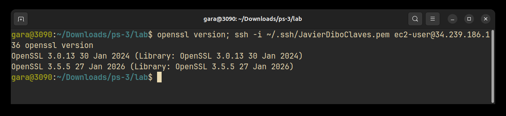

### Benchmark SSL del servidor Apache de AWS

`openssl s_time` abre conexiones TLS seguidas durante un tiempo fijo. Con `-new` hace un handshake completo en cada conexión. Con `-reuse` reutiliza la sesión. `-www /` pide la página, para que cuente también la transferencia. Se pasa la CA del Tema 2 con `-CAfile` para validar el certificado [1].

<!-- file: terminal -->
<!-- caption: benchmark por versión de TLS y modo (`-time 10`: cada ejecución dura 11 s reales) -->
```bash
for v in tls1_2 tls1_3; do for m in new reuse; do
  openssl s_time -connect 34.239.186.136:443 -CAfile ca_actividad1.crt \
    -$m -$v -www / -time 10 2>&1 | tail -1
done; done
```


<!-- caption: resultados de s_time (11 s reales por ejecución) -->
| Versión | Modo | Conexiones en 11 s | Bytes por conexión | Tiempo por conexión | RTT previstos |
|---|---|---|---|---|---|
| TLS 1.2 | `-new` | 27 | 316 | 0,41 s | 4 |
| TLS 1.2 | `-reuse` | 35 | 316 | 0,31 s | 3 |
| TLS 1.3 | `-new` | 36 | 316 | 0,31 s | 3 |
| TLS 1.3 | `-reuse` | 35 | 316 | 0,31 s | 3 |

La prueba es secuencial y mide sobre todo la latencia de red hasta `us-east-1`. Cada conexión espera varias idas y vueltas (RTT). Por eso se lee el número de conexiones en tiempo real y no la columna "connections/user sec", que solo cuenta tiempo de CPU del cliente. El servidor ignora ICMP, así que no hay `ping`. El RTT sale de la actividad 3.2: el `SYN-ACK` llega a los 0,099 s y Nmap informa una latencia de 0,09 s (`Host is up (0.090s latency)`). Con unos 0,1 s por RTT, los datos cuadran con el número de idas y vueltas de cada caso:

- **TLS 1.2, `-new`: 4 RTT.** Uno para TCP, dos para el handshake completo y uno para la petición HTTP. Son 0,4 s por conexión, unas 27 en 11 s.
- **TLS 1.2, `-reuse`: 3 RTT.** El handshake abreviado con ticket cuesta una sola ida y vuelta.
- **TLS 1.3, `-new`: 3 RTT.** El handshake completo de 1.3 también cuesta una.
- **TLS 1.3, `-reuse`: 3 RTT, sin mejora.** La reanudación con PSK sigue necesitando una ida y vuelta antes de enviar datos. Solo 0-RTT las ahorraría, y `s_time` no lo usa.

Por eso TLS 1.2 con `-reuse`, TLS 1.3 con `-new` y TLS 1.3 con `-reuse` quedan empatados (35 o 36 conexiones). Cada ejecución es una sola medición, así que 35 y 36 son el mismo valor.

### Conexión con `s_client` y petición `GET`

`-servername` envía SNI. `-verify_hostname` comprueba que el nombre coincide con el `subjectAltName` del certificado [1].

<!-- file: terminal -->
<!-- caption: petición HTTP/1.1 a Apache sobre TLS -->
```bash
printf 'GET / HTTP/1.1\r\nHost: web.protocolos.test\r\nConnection: close\r\n\r\n' |
  openssl s_client -connect 34.239.186.136:443 -servername web.protocolos.test \
    -CAfile ca_actividad1.crt -verify_hostname web.protocolos.test -brief
```


Con `-quiet` en lugar de `-brief` se ve también la respuesta de Apache:


### Certificado autofirmado

Un solo comando crea la clave RSA de 2048 bits (`-nodes` la deja sin frase de paso) y el certificado. El `subjectAltName` hace falta porque los clientes modernos ignoran el `CN`. El comando sigue el ejemplo de autofirmado de la referencia [1].

<!-- file: terminal -->
<!-- caption: certificado autofirmado para localhost -->
```bash
openssl req -x509 -newkey rsa:2048 -nodes -keyout localhost.key -out localhost.crt \
  -days 365 -subj "/C=ES/O=Protocolos de Seguridad/CN=localhost" \
  -addext "subjectAltName=DNS:localhost,IP:127.0.0.1" 2>/dev/null
openssl x509 -in localhost.crt -noout -subject -issuer -dates -ext subjectAltName
```

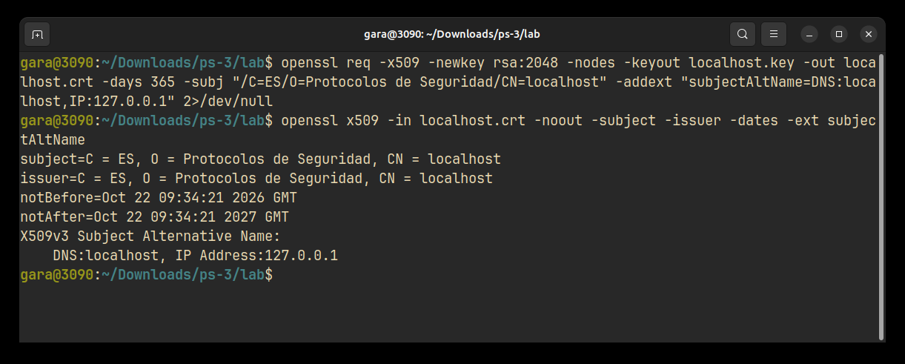

### Servidor web seguro local con `s_server`

`-WWW` sirve los ficheros del directorio actual como un servidor web sencillo. `-tls1_3` limita el servidor a TLS 1.3. El uso básico de `s_server` sale en la referencia [1].

<!-- file: terminal -->
<!-- caption: servidor local en el puerto 4433 -->
```bash
echo "<h1>Hola desde s_server</h1>" > index.html
openssl s_server -accept 4433 -cert localhost.crt -key localhost.key -WWW -tls1_3
```


### Cliente contra el servidor local

Como el certificado es autofirmado, se usa como su propia CA con `-CAfile localhost.crt`. Sin esa opción, `s_client` informa `self-signed certificate`.

<!-- file: terminal -->
<!-- caption: petición al servidor local y respuesta -->
```bash
printf 'GET /index.html HTTP/1.0\r\n\r\n' |
  openssl s_client -connect localhost:4433 -CAfile localhost.crt -quiet
```


La petición usa HTTP/1.0 porque HTTP/1.1 exige la cabecera `Host` y `s_server -WWW` no la procesa: responde siempre en HTTP/1.0. Es una herramienta de prueba, no un servidor web completo. El aviso `Can't use SSL_get_servername` es del cliente: OpenSSL 3.0 no envía SNI cuando se conecta a un nombre como `localhost`, salvo que se pida con `-servername localhost`. Con esa opción el aviso desaparece. No afecta a la conexión.

### Soporte de TLS 1.3

<!-- caption: soporte de TLS 1.3 por componente -->
| Componente | ¿TLS 1.3? | Cómo se configura |
|---|---|---|
| `openssl s_client` 3.0.13 (local) | Sí | Es el valor por defecto. `-tls1_3` lo fuerza. `-ciphersuites` elige las suites de TLS 1.3. |
| `openssl s_server` 3.0.13 | Sí | Por defecto negocia 1.2 y 1.3. `-tls1_3` solo admite 1.3. `-no_tls1_3` lo desactiva. |
| `openssl s_time` | Sí | `-tls1_3` fuerza esa versión. |
| Apache 2.4.63 + OpenSSL 3.5.5 (AWS) | Sí | `mod_ssl` usa `SSLProtocol`. Su valor por defecto es `all -SSLv3` [2]. En RHEL 10 el `ssl.conf` trae la directiva comentada (`#SSLProtocol all -SSLv3`) y `SSLCipherSuite PROFILE=SYSTEM`, así que manda la política criptográfica del sistema: `TLS.MinProtocol = TLSv1.2` y `TLS.MaxProtocol = TLSv1.3`. |

La política activa en la instancia sale de `/etc/crypto-policies/back-ends/opensslcnf.config`:

<!-- caption: política criptográfica `DEFAULT` de RHEL 10 en la instancia -->
```txt
TLS.MinProtocol = TLSv1.2
TLS.MaxProtocol = TLSv1.3
```

Se comprobó el servidor de AWS con `s_client -tls1_2` y `-tls1_3`. Ambas versiones se negocian:

<!-- caption: versiones y suites que negocia Apache -->
```txt
tls1_2: Protocol version: TLSv1.2  Ciphersuite: ECDHE-RSA-AES256-GCM-SHA384
tls1_3: Protocol version: TLSv1.3  Ciphersuite: TLS_AES_256_GCM_SHA384
```

Con `-tls1` y `-tls1_1` el cliente local falla con `no protocols available`. Es la política del cliente de Ubuntu, no una prueba sobre el servidor. El servidor tampoco lo aceptaría, porque la política `DEFAULT` de RHEL 10 fija TLS 1.2 como mínimo.

Con el `s_server` en modo `-tls1_3`, un cliente que fuerza TLS 1.2 recibe una alerta y la conexión termina:

<!-- caption: cliente TLS 1.2 contra servidor solo TLS 1.3 -->
```txt
error:0A00042E:SSL routines:ssl3_read_bytes:tlsv1 alert protocol version:... SSL alert number 70
```

Para activar TLS 1.3 en Apache basta `SSLProtocol -all +TLSv1.2 +TLSv1.3` en `ssl.conf` y reiniciar `httpd`. La instancia ya lo hace por defecto.

**Diferencias al usar TLS 1.3:**

- **Handshake de 1 RTT** (una ida y vuelta) en lugar de 2 en TLS 1.2. Es lo que se ve en el benchmark de la sección 1.2.
- **Solo suites AEAD** (`TLS_AES_256_GCM_SHA384`, `TLS_CHACHA20_POLY1305_SHA256`, ...). La suite ya no incluye el intercambio de claves ni la firma. Se negocian aparte.
- **Secreto perfecto hacia adelante obligatorio.** Se elimina el intercambio de claves con RSA. Solo hay (EC)DHE, aquí X25519.
- **Certificado cifrado.** En TLS 1.2 el certificado del servidor viaja en claro. En TLS 1.3 va cifrado tras el `ServerHello`. Un análisis de tráfico ya no lo ve. Se comprueba en la Actividad 3.2.
- **Reanudación con tickets (PSK)** y envío opcional de datos en 0-RTT. 0-RTT es vulnerable a repetición y Apache no lo activa por defecto.
- Se eliminan RC4, 3DES, CBC, SHA-1 y la compresión.

## Actividad 3.2: Análisis de tráfico TLS

El objetivo es capturar con Wireshark una conexión TLS 1.2 y otra TLS 1.3, identificar los paquetes del handshake, explicar su contenido y comparar las dos versiones.

### Entorno de trabajo

Se usan dos instancias EC2 con la misma AMI. Cada una sirve una página sencilla con una sola versión de TLS. El cliente es Firefox en el equipo local. Wireshark captura el tráfico en la interfaz de red del equipo.

<!-- caption: servidores de la práctica -->
| | Act1 (`JavierDiboAct1`) | Act2 (`JavierDiboAct2`) |
|---|---|---|
| Instancia | `i-02b1de6987216edf4` | `i-0d64a92576b7ad998` |
| AMI | `ami-00adafae70b8029d8` | `ami-00adafae70b8029d8` |
| Sistema | Red Hat Enterprise Linux 10.2 | Red Hat Enterprise Linux 10.2 |
| Tipo y zona | t3.micro, `us-east-1a` | t3.micro, `us-east-1a` |
| IP pública | `32.198.126.208` | `100.24.14.67` |
| Servidor web | Apache 2.4.63 + `mod_ssl`, OpenSSL 3.5.5 | Apache 2.4.63 + `mod_ssl`, OpenSSL 3.5.5 |
| Versión de TLS | solo TLS 1.2 | solo TLS 1.3 |
| Página | `Act1: TLS 1.2` | `Act2: TLS 1.3` |

Las dos instancias existían antes de esta práctica, con la clave `JavierDiboClaves`. Act1 ya tenía Apache (`httpd` instalado el 6 de octubre) y Act2 no tenía servidor web. La preparación descrita abajo se hizo el 21 de octubre de 2026. Las IP públicas no son elásticas y cambian si se para la instancia.

<!-- caption: equipo local -->
| Componente | Versión |
|---|---|
| Sistema | Ubuntu 24.04.5 LTS |
| Wireshark | 4.2.2 (`dumpcap` y `editcap` incluidos) |
| Navegador | Firefox 158.0 |
| Cliente de pruebas | OpenSSL 3.0.13 (`openssl s_client`) |
| Interfaz de captura | `enp34s0` (Ethernet) |

Los dos servidores usan el certificado de `web.protocolos.test`, firmado por la CA de la práctica del Tema 2 (`CA Protocolos de Seguridad`). Es el mismo certificado y la misma clave en las dos instancias, para que la única diferencia sea la versión de TLS. Compartir la clave privada entre servidores es un atajo aceptable en una práctica y no en producción.

### Configuración de los servidores

**Act1: CA y certificado.** La CA y el certificado se crearon en la propia instancia, en `~/ca`. Los tres ficheros `.cnf` fijan el sujeto de la CA (`CA Protocolos de Seguridad`, `CA:TRUE`, `pathlen:0`), el sujeto del servidor (`CN=web.protocolos.test`) y las extensiones del certificado (`CA:FALSE`, `serverAuth` y `subjectAltName = DNS:web.protocolos.test`). La clave de la CA es RSA de 4096 bits y lleva frase de paso. El certificado del servidor es RSA de 2048 bits, válido 365 días:

<!-- file: terminal -->
<!-- caption: Act1, CA de la práctica y certificado del servidor -->
```bash
mkdir ~/ca && cd ~/ca            # aquí ca.cnf, server.cnf y server_ext.cnf
openssl req -x509 -newkey rsa:4096 -keyout ca.key -out ca.crt \
  -days 3650 -config ca.cnf
openssl req -new -newkey rsa:2048 -nodes -keyout server.key \
  -out server.csr -config server.cnf
openssl x509 -req -in server.csr -CA ca.crt -CAkey ca.key -CAcreateserial \
  -out server.crt -days 365 -sha256 -extfile server_ext.cnf
openssl verify -CAfile ca.crt server.crt
```

**Act1: Apache y TLS 1.2.** Se instala `mod_ssl`, se copian el certificado y la clave a `/etc/pki/tls` y se cambian tres líneas de `ssl.conf`: `ServerName`, `SSLCertificateFile` y `SSLCertificateKeyFile`. Se guarda esa versión como `ssl.conf.orig`. Después se añade `SSLProtocol` dentro del `VirtualHost`, justo después de `SSLEngine on`, y se reinicia Apache [2]:

<!-- file: terminal -->
<!-- caption: Act1 con el certificado de la práctica y limitada a TLS 1.2 -->
```bash
sudo dnf install -y mod_ssl
sudo cp ~/ca/server.crt /etc/pki/tls/certs/web.protocolos.test.crt
sudo cp ~/ca/server.key /etc/pki/tls/private/web.protocolos.test.key
sudo sed -i \
  -e 's|^#ServerName www.example.com:443|ServerName web.protocolos.test:443|' \
  -e 's|certs/localhost.crt|certs/web.protocolos.test.crt|' \
  -e 's|private/localhost.key|private/web.protocolos.test.key|' \
  /etc/httpd/conf.d/ssl.conf
sudo cp /etc/httpd/conf.d/ssl.conf /etc/httpd/conf.d/ssl.conf.orig
sudo sed -i '/^SSLEngine on/a SSLProtocol -all +TLSv1.2' \
  /etc/httpd/conf.d/ssl.conf
sudo apachectl configtest && sudo systemctl restart httpd
echo '<h1>Act1: TLS 1.2</h1>' | sudo tee /var/www/html/index.html
```

**Act2 (TLS 1.3).** La instancia no tenía servidor web. Se instala Apache y se copian desde Act1 el certificado, la clave y `ssl.conf.orig`, la versión **sin** la línea de `SSLProtocol`. Si se copiara el `ssl.conf` de Act1, el `sed` añadiría una segunda directiva `SSLProtocol` encima de la de TLS 1.2. Por eso se parte de `ssl.conf.orig`:

<!-- file: terminal -->
<!-- caption: Act2 con Apache y solo TLS 1.3 -->
```bash
sudo dnf install -y httpd mod_ssl
# desde el equipo local, por SSH con la clave JavierDiboClaves.pem
A1="ssh -i $HOME/.ssh/JavierDiboClaves.pem ec2-user@<IP-Act1>"
A2="ssh -i $HOME/.ssh/JavierDiboClaves.pem ec2-user@<IP-Act2>"
$A1 'sudo cat /etc/pki/tls/certs/web.protocolos.test.crt' |
  $A2 'sudo tee /etc/pki/tls/certs/web.protocolos.test.crt >/dev/null'
$A1 'sudo cat /etc/pki/tls/private/web.protocolos.test.key' |
  $A2 'sudo tee /etc/pki/tls/private/web.protocolos.test.key >/dev/null'
$A1 'sudo cat /etc/httpd/conf.d/ssl.conf.orig' |
  $A2 'sudo tee /etc/httpd/conf.d/ssl.conf >/dev/null'
# en Act2:
sudo sed -i '/^SSLEngine on/a SSLProtocol -all +TLSv1.3' \
  /etc/httpd/conf.d/ssl.conf
echo '<h1>Act2: TLS 1.3</h1>' | sudo tee /var/www/html/index.html
sudo restorecon -R /etc/pki/tls /var/www/html /etc/httpd
sudo apachectl configtest && sudo systemctl enable --now httpd
```

El grupo de seguridad `launch-wizard-2` no permitía el puerto 443. Se añadió una regla de entrada HTTPS (TCP 443, origen `0.0.0.0/0`) en la consola de AWS. Hasta entonces el servidor respondía en local y no desde fuera.

Cada `ssl.conf` tiene ahora una sola directiva `SSLProtocol`. Esta es la salida real de `grep -n '^SSLProtocol' /etc/httpd/conf.d/ssl.conf` en cada instancia:

<!-- caption: directiva `SSLProtocol` activa en cada instancia -->
```txt
Act1:  55:SSLProtocol -all +TLSv1.2
Act2:  55:SSLProtocol -all +TLSv1.3
```

**Comprobación.** Se probó cada servidor con `openssl s_client` forzando cada versión, con la CA de la práctica y la comprobación del nombre:

<!-- caption: comprobación de las versiones que acepta cada servidor -->
| Servidor | Cliente forzado a TLS 1.2 | Cliente forzado a TLS 1.3 |
|---|---|---|
| Act1 | responde `<h1>Act1: TLS 1.2</h1>` | alerta `tlsv1 alert protocol version` (número 70) |
| Act2 | alerta `tlsv1 alert protocol version` (número 70) | responde `<h1>Act2: TLS 1.3</h1>` |

Cada servidor acepta solo su versión. La alerta 70 es la respuesta esperada cuando el cliente no ofrece una versión que el servidor admita.

### Método de captura

El certificado solo es válido para `web.protocolos.test`. Por eso se apunta ese nombre a la IP de cada servidor en `/etc/hosts` antes de cada prueba. Se usa un perfil de Firefox independiente que confía en la CA de la práctica, así no se toca el perfil habitual:

<!-- file: terminal -->
<!-- caption: perfil de Firefox que confía en la CA de la práctica -->
```bash
certutil -N -d sql:perfil --empty-password
certutil -A -n "CA Protocolos" -t "C,," -i ca_actividad1.crt -d sql:perfil
```

Para cada servidor se repite el mismo procedimiento:

1. Se inicia la captura con la herramienta de Wireshark `dumpcap`, con el filtro `host <IP> and tcp port 443` [3].
2. Se abre Firefox con la variable `SSLKEYLOGFILE`. Firefox escribe en ese fichero los secretos de cada sesión TLS. Sin ellos, Wireshark no puede descifrar el tráfico de aplicación [3]. Vale para las dos versiones: con ECDHE, ni siquiera la clave privada RSA del servidor sirve para descifrar una sesión, porque el secreto sale de claves efímeras.
3. Se visita `https://web.protocolos.test/`, después `/index.html` en otra pestaña, y se espera unos segundos con el navegador abierto. Apache cierra solo las conexiones inactivas (véase el cierre más abajo). Así hay una conexión nueva, una reanudación y un cierre.
4. Se incrustan las claves en el fichero de captura con `editcap --inject-secrets` [3]. El fichero resultante se abre en Wireshark y descifra solo, sin configurar nada.

<!-- file: terminal -->
<!-- caption: captura y preparación del fichero -->
```bash
dumpcap -i enp34s0 -f 'host 32.198.126.208 and tcp port 443' -w tls12-raw.pcapng
SSLKEYLOGFILE=tls12.keys firefox --no-remote --new-instance --profile perfil \
  https://web.protocolos.test/
editcap --inject-secrets tls,tls12.keys tls12-raw.pcapng tls12.pcapng
```

La guía de la práctica pide "Decode as → SSL". En Wireshark 4.2 ese paso no hace falta, porque el puerto 443 se reconoce como TLS de forma automática. El menú ya no se llama SSL, sino TLS.

Firefox abre dos conexiones TCP a la vez al cargar la página. La segunda completa su handshake y no se usa: en la captura, el flujo 1 no contiene ningún dato de aplicación ni petición HTTP. El análisis sigue la conexión que lleva la petición `GET /`, con el filtro `tcp.stream eq 0 && (tls || http)`. Los paquetes del handshake y del cierre se marcan con "Mark packet" de Wireshark (filas negras). La [[fig-2-1]] y la [[fig-2-2]] muestran el navegador en cada servidor.


### Conexión TLS 1.2 (Act1)

El flujo de mensajes es el del handshake de TLS 1.2 [4, §7.3]. La [[fig-2-3]] resume la conexión. Las filas negras son los paquetes del handshake y del cierre. Las filas verdes son la petición y la respuesta HTTP.

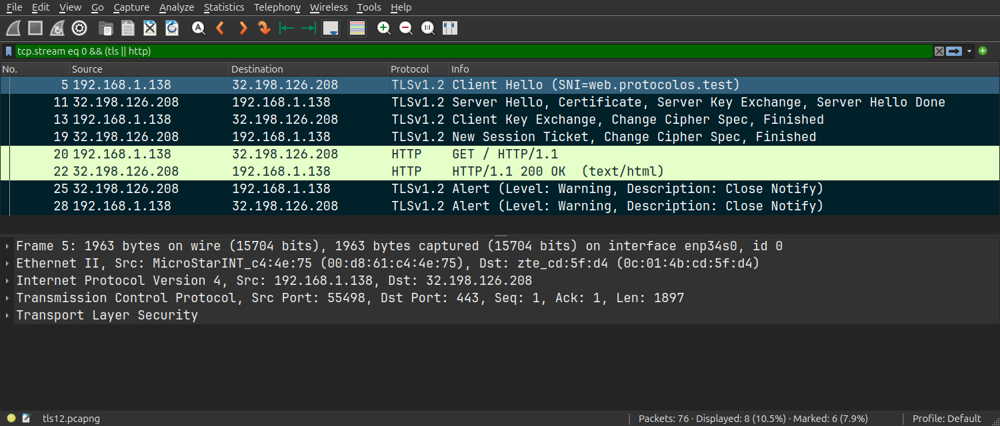

<!-- caption: paquetes de la conexión TLS 1.2 -->
| Nº | Sentido | Mensajes | Función |
|---|---|---|---|
| 5 | cliente → servidor | `Client Hello` | El cliente ofrece versiones, suites y extensiones |
| 11 | servidor → cliente | `Server Hello`, `Certificate`, `Server Key Exchange`, `Server Hello Done` | El servidor elige parámetros, envía su certificado y su parte del intercambio de claves |
| 13 | cliente → servidor | `Client Key Exchange`, `Change Cipher Spec`, `Finished` | El cliente envía su parte, activa el cifrado y confirma el handshake |
| 19 | servidor → cliente | `New Session Ticket`, `Change Cipher Spec`, `Finished` | El servidor da un ticket de reanudación, activa el cifrado y confirma |
| 20 y 22 | ambos | `GET /` y `200 OK` | Datos de aplicación (cifrados en el cable) |
| 25 y 28 | ambos | `Alert: Close Notify` | Cierre ordenado de la conexión TLS |

**Cuántas idas y vueltas.** El `SYN-ACK` llega 99 ms después del `SYN`, así que una ida y vuelta (RTT) dura unos 100 ms. El `Client Hello` sale a los 100 ms. El cliente envía el `GET` a los 302 ms, es decir, 202 ms después del `Client Hello`. El handshake de TLS 1.2 cuesta dos RTT antes de enviar datos. La [[fig-2-3]] no muestra la columna de tiempo. Estos son los instantes de la columna *Time* de Wireshark (`frame.time_relative`, en segundos desde el primer paquete), leídos con `tshark` del mismo fichero:

<!-- file: terminal -->
<!-- caption: instantes de la conexión TLS 1.2 -->
```bash
tshark -r tls12.pcapng \
  -Y 'tcp.stream==0 && (http || tls.handshake.type==1 || tcp.flags.syn==1)' \
  -T fields -e frame.number -e frame.time_relative -e _ws.col.Info
```

<!-- caption: salida (columna Info abreviada): la petición sale 0,202 s después del `Client Hello` -->
```txt
1    0.000   55498 → 443 [SYN]
3    0.099   443 → 55498 [SYN, ACK]
5    0.100   Client Hello (SNI=web.protocolos.test)
20   0.302   GET / HTTP/1.1
22   0.402   HTTP/1.1 200 OK  (text/html)
```

**`Client Hello` (paquete 5).** La [[fig-2-4]] muestra el primer mensaje. La versión del registro es TLS 1.0 (`0x0301`) y la del mensaje es TLS 1.2 (`0x0303`). Son valores heredados por compatibilidad. El mensaje lleva 32 bytes aleatorios, un identificador de sesión de 32 bytes y 15 suites de cifrado. Las tres primeras son de TLS 1.3 (`0x1301`, `0x1303`, `0x1302`). Siguen suites de TLS 1.2 como `ECDHE_ECDSA_WITH_AES_128_GCM_SHA256` (`0xc02b`) y `ECDHE_RSA_WITH_AES_256_GCM_SHA384` (`0xc030`). La extensión `server_name` lleva `web.protocolos.test` (SNI), que permite al servidor elegir el certificado.


**`Server Hello` (paquete 11).** La [[fig-2-5]] muestra la elección del servidor. Elige la suite `TLS_ECDHE_RSA_WITH_AES_256_GCM_SHA384` (`0xc030`). Esa suite dice que el intercambio de claves es ECDHE, la autenticación es RSA, el cifrado es AES-256-GCM y el hash es SHA-384. El identificador de sesión es de longitud 0, porque el servidor va a entregar un ticket [5, §3.4]. Las extensiones incluyen `extended_master_secret`, `session_ticket` y la negociación de protocolo de aplicación.


**`Certificate` (paquete 11).** En el mismo paquete viaja el certificado, en claro. Mide 1292 bytes. La [[fig-2-7]] lo despliega: versión 3, firma `sha256WithRSAEncryption` y emisor `CA Protocolos de Seguridad`. Cualquiera que capture el tráfico lee la identidad del servidor.


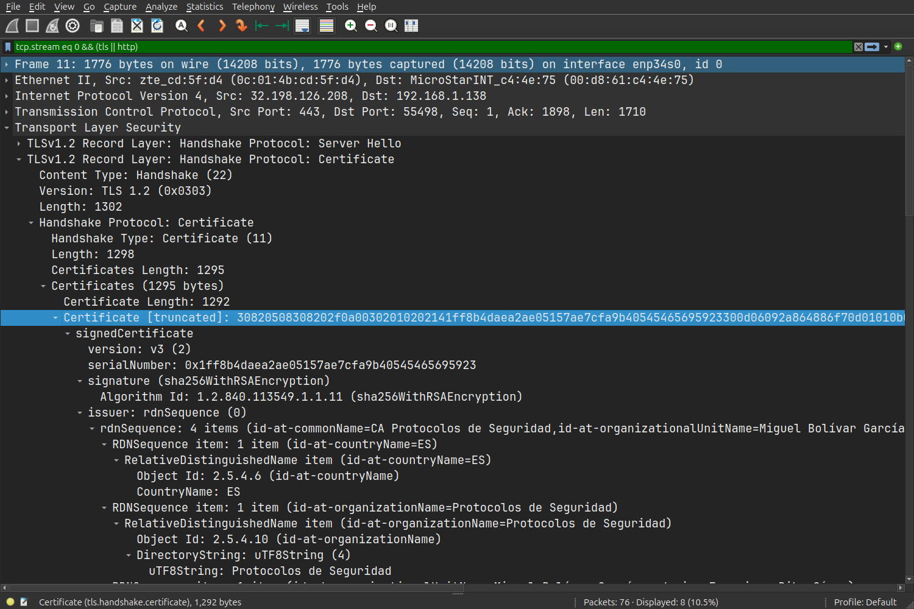

**`Server Key Exchange` (paquete 11).** La [[fig-2-8]] muestra los parámetros de Diffie-Hellman de curva elíptica. La curva es `x25519` (`0x001d`) y la clave pública del servidor mide 32 bytes. El servidor firma estos parámetros con la clave RSA de su certificado (`rsa_pss_rsae_sha256`, firma de 256 bytes). La firma autentica al servidor. Como la clave DH es efímera, la sesión tiene secreto perfecto hacia adelante.


**`Client Key Exchange`, `Change Cipher Spec` y `Finished` (paquete 13).** El cliente responde con su clave pública de curva elíptica. Con las dos claves, cada lado calcula el mismo secreto. Después `Change Cipher Spec` indica que los mensajes siguientes van cifrados. `Finished` confirma todo el handshake y ya viaja cifrado.


**`New Session Ticket` (paquete 19).** El servidor entrega un ticket (246 bytes de mensaje) que contiene el estado de la sesión, cifrado con una clave que solo el servidor conoce. En TLS 1.2 llega antes del `Change Cipher Spec` y del `Finished` del servidor [5, §3.3]. El ticket se usa en la conexión siguiente.


**Reanudación.** Firefox abrió después otra conexión para `/index.html`. Esta vez no hay `Certificate` ni intercambio de claves. Son tres mensajes y una sola ida y vuelta:

<!-- caption: handshake abreviado de TLS 1.2 al reanudar con el ticket -->
```txt
46  13.461  Client Hello (SNI=web.protocolos.test)
55  13.570  Server Hello, Change Cipher Spec, Finished
57  13.570  Change Cipher Spec, Finished
```

**Cierre (paquetes 25 y 28).** Cada lado envía una alerta de nivel `Warning` con descripción `Close Notify`. Es el cierre ordenado de TLS, que evita ataques de truncamiento [4, §7.2.1]. El tipo del registro es `Alert (21)` y se ve en claro. **Lo envía primero el servidor** (paquete 25, origen `32.198.126.208`), 5,005 s después de la respuesta `200 OK` (0,402 s) y con el navegador abierto. Es el `KeepAliveTimeout` de Apache, que vale 5 s por defecto [6]: `httpd.conf` no lo cambia. El cliente contesta con su propio `Close Notify` (paquete 28). La reanudación de `/index.html`, a los 13 s, usa el mismo Firefox sin cerrar. Por eso este cierre es por inactividad y no por cerrar el navegador.


### Conexión TLS 1.3 (Act2)

La [[fig-2-12]] resume la conexión con las claves de sesión cargadas. La [[fig-2-13]] muestra el mismo tráfico sin ellas.

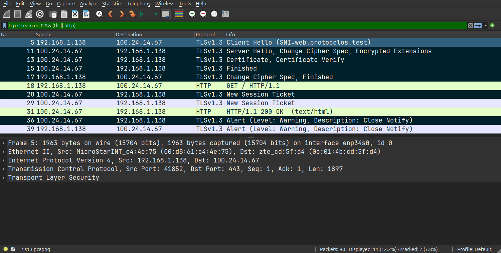


<!-- caption: paquetes de la conexión TLS 1.3 -->
| Nº | Sentido | Mensajes | Función |
|---|---|---|---|
| 5 | cliente → servidor | `Client Hello` | El cliente ofrece versiones, suites y su parte del intercambio de claves |
| 11 | servidor → cliente | `Server Hello`, `Change Cipher Spec`, `Encrypted Extensions` | El servidor elige parámetros y su parte de la clave. Lo que sigue va cifrado |
| 13 | servidor → cliente | `Certificate`, `Certificate Verify` | Certificado y firma, ya cifrados |
| 15 | servidor → cliente | `Finished` | Confirma el handshake |
| 17 | cliente → servidor | `Change Cipher Spec`, `Finished` | Confirma el handshake del cliente |
| 18 | cliente → servidor | `GET /` | Datos de aplicación, enviados sin esperar más |
| 28 y 29 | servidor → cliente | `New Session Ticket` (dos) | Tickets para reanudar |
| 31 | servidor → cliente | `200 OK` | Respuesta |
| 36 y 39 | ambos | `Alert: Close Notify` | Cierre ordenado |

**Cuántas idas y vueltas.** El `SYN-ACK` llega a los 101 ms. El `Client Hello` sale a los 102 ms y el cliente envía el `GET` a los 208 ms. Pasan 106 ms, una sola ida y vuelta. Es unos 96 ms menos que en TLS 1.2. La diferencia es un RTT. Los instantes salen de la misma consulta de `tshark`, sobre `tls13.pcapng`:

<!-- caption: salida para TLS 1.3 (columna Info abreviada): la petición sale 0,106 s después del `Client Hello` -->
```txt
1    0.000   41852 → 443 [SYN]
3    0.101   443 → 41852 [SYN, ACK]
5    0.102   Client Hello (SNI=web.protocolos.test)
18   0.208   GET / HTTP/1.1
31   0.309   HTTP/1.1 200 OK  (text/html)
```

**`Client Hello` (paquete 5).** Es el mismo mensaje que en TLS 1.2, porque lo envía el mismo navegador. Cambia lo que el servidor hace con él. La [[fig-2-14]] muestra dos extensiones clave. `supported_versions` ofrece TLS 1.3 y TLS 1.2 [7, §4.2.1]: así se negocia la versión real, y por eso el campo de versión del mensaje sigue en `0x0303`. `key_share` envía ya las claves públicas para tres grupos [7, §4.2.8]: `x25519`, `secp256r1` y el grupo `4588`. En TLS 1.3 el cliente adivina el grupo y adelanta su clave. Por eso el servidor puede responder en una sola vuelta.


**`Server Hello` (paquete 11).** La [[fig-2-15]] muestra que el servidor elige `TLS_AES_256_GCM_SHA384` (`0x1302`). La suite solo nombra el cifrado y el hash. La extensión `supported_versions` confirma TLS 1.3. La extensión `key_share` elige el grupo `4588`. Wireshark 4.2 lo muestra como `Unknown`. Es el grupo híbrido `X25519MLKEM768` (4588, `0x11EC`), que combina X25519 con el mecanismo poscuántico ML-KEM-768. Lo define el RFC 10024, que registra el código 0x11EC [8, §7.1]. Por eso el `key_share` mide 1124 bytes (1120 de la parte del servidor [8, §4.2] y 4 de cabecera) y el registro del `Server Hello` mide 1210 bytes, frente a los 84 de TLS 1.2.

El registro `Change Cipher Spec` del paquete 11 no sirve para nada en TLS 1.3. Se envía por compatibilidad con dispositivos intermedios (RFC 8446, apéndice D.4) [7]. Por el mismo motivo el `Server Hello` devuelve el identificador de sesión de 32 bytes que mandó el cliente, aunque TLS 1.3 ya no use sesiones: el cliente activa así el modo de compatibilidad. `Encrypted Extensions` ya va cifrado.


**`Certificate` (paquete 13).** Es la diferencia más visible. Sin las claves, la [[fig-2-16]] solo muestra un registro `Application Data` de 1322 bytes. El tipo opaco es 23 (`Application Data`) y el contenido es un bloque cifrado. Un observador de la red no puede leer el certificado. Con las claves, la [[fig-2-17]] muestra que ese bloque contiene un `Handshake Protocol: Certificate`, el mismo certificado de 1292 bytes que en Act1. Este paquete también sirve de ejemplo del reensamblado: el mensaje empieza en el paquete 11 y termina en el 13.


**`Certificate Verify` y `Finished` (paquetes 13 a 17).** `Certificate Verify` es la firma del servidor sobre todo el handshake hasta ese punto. Sustituye a la firma del `Server Key Exchange` de TLS 1.2. `Finished` confirma el handshake. El cliente responde con su `Finished` y envía el `GET` a continuación.


**`New Session Ticket` (paquetes 28 y 29).** En TLS 1.3 los tickets llegan después del handshake y cifrados [7, §4.6.1]. La [[fig-2-19]] muestra que el registro es `Application Data` por fuera y `Handshake` (22) por dentro. Con el ticket, la conexión siguiente se reanuda con una clave precompartida (PSK). La reanudación de la segunda página no envía certificado. El `Client Hello` lleva dos extensiones nuevas. `psk_key_exchange_modes` ofrece `psk_dhe_ke` (valor 1) [7, §4.2.9]: la PSK se combina con un intercambio (EC)DHE nuevo, así que la reanudación conserva el secreto perfecto hacia adelante. `pre_shared_key` lleva el ticket (identidad de 272 bytes) [7, §4.2.11]. El `Server Hello` la acepta con `selected_identity = 0` y repite el `key_share` del grupo híbrido:


<!-- caption: reanudación con PSK en TLS 1.3 -->
```txt
58  13.423  Client Hello (SNI=web.protocolos.test)
67  13.528  Server Hello, Change Cipher Spec, Encrypted Extensions, Finished
69  13.529  Change Cipher Spec, Finished
74  13.633  New Session Ticket
```

**Cierre (paquetes 36 y 39).** También hay `Close Notify`, y también lo envía primero el servidor (paquete 36, origen `100.24.14.67`) tras 5,006 s de inactividad. A diferencia de TLS 1.2, la alerta va cifrada: por fuera es `Application Data` (23) y el tipo `Alert` (21) solo se ve con las claves.


### Diferencias entre TLS 1.2 y TLS 1.3

<!-- caption: diferencias observadas en las capturas -->
| Aspecto | TLS 1.2 (Act1) | TLS 1.3 (Act2) |
|---|---|---|
| Tiempo hasta el primer `GET` | 202 ms tras el `Client Hello` (2 RTT) | 106 ms tras el `Client Hello` (1 RTT) |
| Suite elegida | `TLS_ECDHE_RSA_WITH_AES_256_GCM_SHA384`: intercambio, autenticación, cifrado y hash en el nombre | `TLS_AES_256_GCM_SHA384`: solo cifrado y hash |
| Intercambio de claves | `Server Key Exchange` y `Client Key Exchange` tras el `Hello`. Curva x25519 | `key_share` dentro de los `Hello`. Grupo híbrido X25519MLKEM768 |
| Autenticación del servidor | Firma en el `Server Key Exchange` | Mensaje `Certificate Verify` sobre todo el handshake |
| Certificado | En claro, visible en la captura | Cifrado. Solo se lee con las claves |
| Mensajes tras el `Server Hello` | En claro hasta `Change Cipher Spec` | Cifrados desde `Encrypted Extensions` |
| `Change Cipher Spec` | Activa el cifrado | Solo por compatibilidad |
| Señal de versión | Campo de versión del `Hello` | Extensión `supported_versions` |
| Tickets de sesión | Antes del `Finished` del servidor | Después del handshake, cifrados |
| Reanudación | Handshake abreviado con el ticket | PSK, sin certificado |
| Alerta de cierre | En claro | Cifrada |

La ventaja de TLS 1.3 es doble: es más rápido, porque ahorra una ida y vuelta, y expone menos información, porque cifra el certificado y casi todo el handshake. TLS 1.3 elimina además las opciones débiles de TLS 1.2: intercambio RSA, CBC, SHA-1 y compresión. Las claves de sesión (`SSLKEYLOGFILE`) hacen falta en las dos versiones. Con ECDHE, también en TLS 1.2, ni la clave privada RSA del servidor descifra el tráfico de aplicación: el secreto sale de claves efímeras. La diferencia es que TLS 1.2 deja el handshake en claro y TLS 1.3 lo cifra. Sin las claves, en TLS 1.3 no se ve ni el certificado.

## Actividad 3.3: Auditoría de servidores y cliente TLS

El objetivo es auditar los dos servidores de la actividad 3.2 y el navegador cliente. Se usa SSL Labs, como pide el enunciado, y dos herramientas más. Después se comparan los resultados.

### Objetivo auditado

Las instancias se reiniciaron el 22 de octubre de 2026 a las 10:42 y recibieron IP públicas nuevas. Las capturas de la actividad 3.2 se hicieron el día anterior con las IP antiguas. Las auditorías de esta actividad se hicieron el 22 de octubre entre las 10:48 y las 11:00 (hora local).

<!-- caption: sistemas auditados -->
| Sistema | Nombre público | IP | Configuración |
|---|---|---|---|
| Act1 | `ec2-34-239-186-136.compute-1.amazonaws.com` | 34.239.186.136 | solo TLS 1.2 |
| Act2 | `ec2-98-91-203-106.compute-1.amazonaws.com` | 98.91.203.106 | solo TLS 1.3 |
| Cliente | Firefox 158.0 en Ubuntu 24.04 | – | el navegador de la actividad 3.2 |

Los dos servidores presentan el certificado de `web.protocolos.test`, firmado por la CA de la práctica. Ese certificado no es válido para el nombre público de AWS y ninguna autoridad pública lo reconoce. Eso condiciona los resultados, como se ve más adelante.

### Herramientas y método

<!-- caption: herramientas usadas -->
| Herramienta | Tipo | Cómo se usó |
|---|---|---|
| SSL Labs, *SSL Server Test* y *SSL Client Test* (`www.ssllabs.com/ssltest`) | Servicio web de Qualys | Se analiza el nombre público de cada instancia desde Internet. Se marca "ignorar discrepancia de nombre" y no se publican los resultados. El test del cliente se abre desde Firefox |
| `testssl.sh` 3.2.0 (`testssl.sh`) | Programa de código abierto, en local | `testssl.sh --add-ca lab/ca_actividad1.crt -p <IP>` para los protocolos y `-S` para los valores del servidor. `--add-ca` añade la CA de la práctica a las raíces de confianza |
| Nmap 7.94SVN, script `ssl-enum-ciphers` [9] | Escáner de red, en local | `nmap --script ssl-enum-ciphers -p 443 <IP>` |

SSL Labs es la referencia del enunciado. `testssl.sh` y Nmap se eligieron porque son gratuitos, se ejecutan desde la terminal y no necesitan que el servidor sea público. Así se pueden repetir en cualquier equipo.

### SSL Labs: servidor Act1 (TLS 1.2)

La [[fig-3-1]] muestra el resumen. La nota es **T**: SSL Labs no confía en el certificado. Debajo de la letra indica que, si se ignoran los problemas de confianza, la nota sería **B**. Los avisos son cuatro: certificado no confiable, cadena incompleta (nota limitada a B), no admite TLS 1.3 y no admite intercambio de claves poscuántico. La cadena aparece incompleta porque el servidor envía solo el certificado hoja (`testssl.sh`: `Certificates provided 1`) y la CA que lo firmó es privada: SSL Labs no la conoce y no puede completar la cadena hasta una raíz que reconozca. El hallazgo es el mismo para los dos servidores.

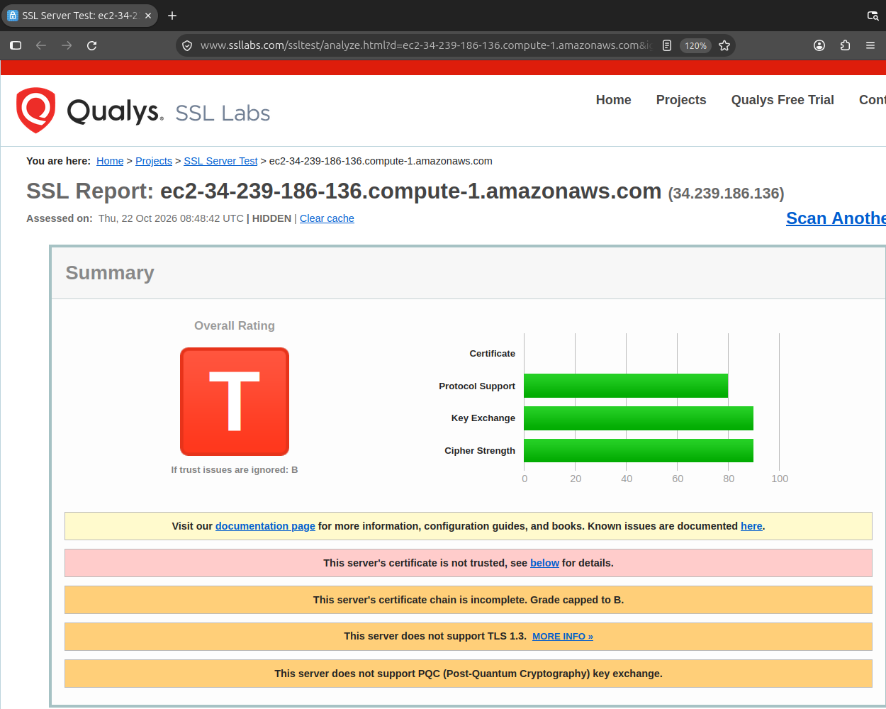

La [[fig-3-2]] muestra la configuración. Solo TLS 1.2 está activo. SSL Labs lista 15 suites en el orden que prefiere el servidor. Marca como `WEAK` las siete que usan CBC: tres con ECDHE (`0xc027`, `0xc014` y `0xc013`) y cuatro con DHE (`0x6b`, `0x67`, `0x39` y `0x33`). La figura muestra las primeras. Todas las suites tienen secreto perfecto hacia adelante: ECDHE con x25519 o DHE de 2048 bits.

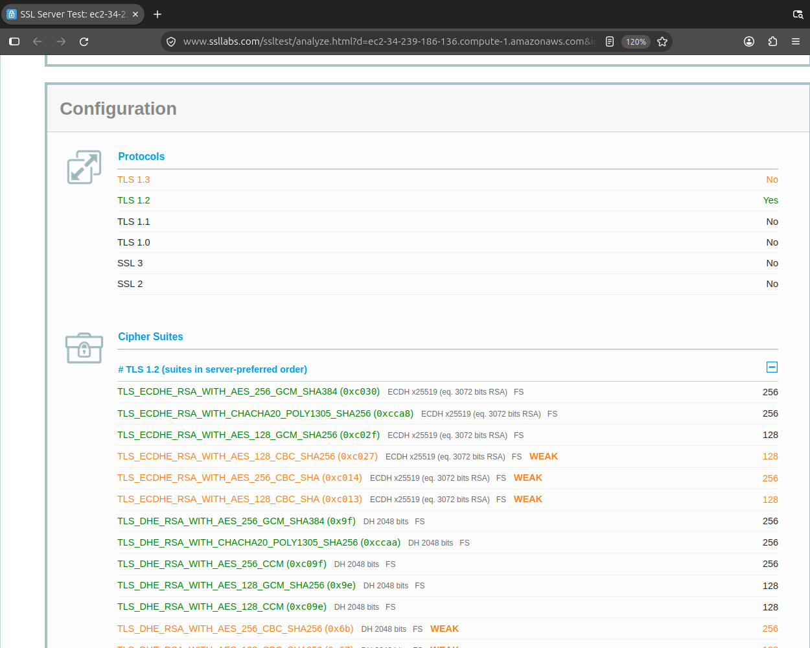

La [[fig-3-3]] muestra el detalle del protocolo. BEAST aparece como mitigado en el servidor. POODLE (SSLv3 y TLS), Zombie POODLE, GOLDENDOODLE, OpenSSL 0-Length y Sleeping POODLE salen como `No`. La renegociación segura está admitida. La figura no llega a Heartbleed, ROBOT, compresión, HSTS ni OCSP stapling. Esos puntos salen de la misma evaluación (respuesta de la API de SSL Labs, que devuelve el mismo informe) y se contrastan con `testssl.sh` y `curl` más abajo: Heartbleed no, ROBOT no, sin compresión, HSTS ausente y OCSP stapling sin activar.

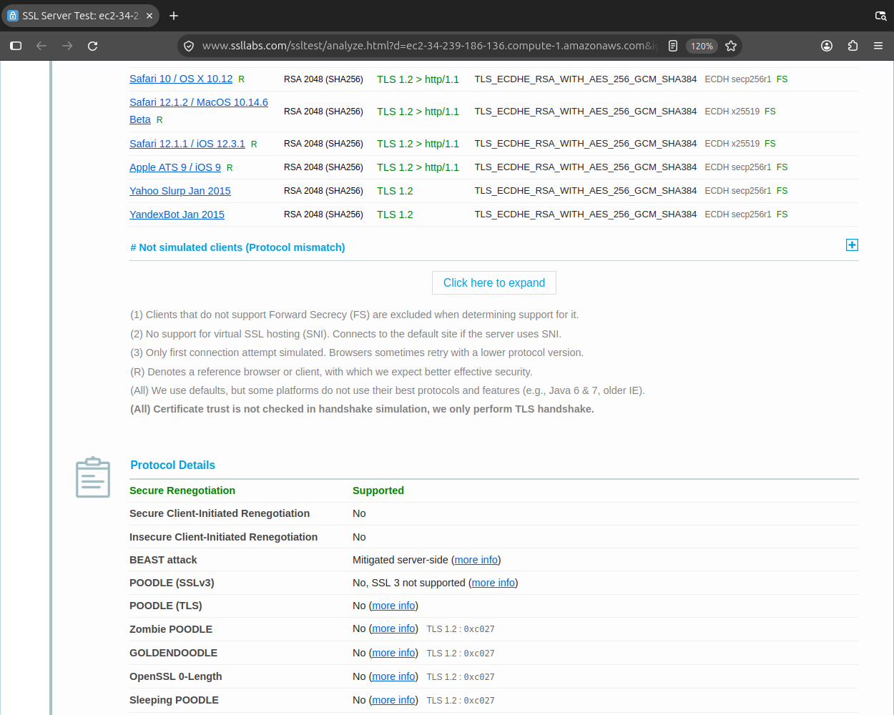

**Por qué la nota es B.** Ni la nota ni la figura dicen qué la limita, y las dos explicaciones que se podían suponer no se sostienen. La *SSL Server Rating Guide*, versión 2009r de 16-may-2025 [10], limita a B una cadena incompleta (entrada 2009i), pero Act2 tiene el mismo aviso y obtiene A. La entrada 2009r limita a A- (no a B) la falta de TLS 1.3 y la ausencia de HSTS. La guía no trata CBC como causa de B. La API informa `criteriaVersion: 2009q` en estos análisis, anterior a la 2009r, así que tampoco se puede atribuir la nota a las reglas nuevas. Se comprobó con un experimento: se cambió la configuración de Act1, se repitió el análisis con la API de SSL Labs, campos `gradeTrustIgnored` y `sessionTickets` [11] (mismo certificado, ignorando la confianza) y se restauró el original. Estos son los resultados:

<!-- caption: nota de Act1 ignorando la confianza, según la configuración (SSL Labs, 22-oct-2026) -->
| Configuración de Act1 | Nota |
|---|---|
| TLS 1.2, 15 suites (la original) | B |
| TLS 1.2 y TLS 1.3 | B |
| TLS 1.2 y TLS 1.3, sin suites CBC | B |
| TLS 1.2 y TLS 1.3, sin CBC ni DHE (solo ECDHE con GCM y ChaCha20) | B |
| Solo TLS 1.3 (la configuración de Act2) | A |

Ni la falta de TLS 1.3 ni las suites CBC ni DHE explican la B. La única variable que la cambió fue desactivar TLS 1.2 por completo. La guía no documenta ese comportamiento, y no se ha podido explicar con ella por qué un servidor con TLS 1.2 conserva el límite de B y otro solo con TLS 1.3 no, con el mismo certificado y la misma cadena. Se deja como resultado medido y no como causa demostrada.

### SSL Labs: servidor Act2 (TLS 1.3)

La [[fig-3-4]] muestra también la nota **T**, pero ignorando la confianza sería **A**. Los avisos son el certificado no confiable, la cadena incompleta y que el sitio solo funciona en navegadores con SNI.

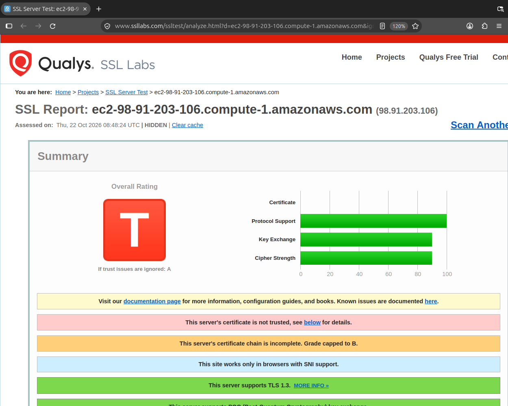

La [[fig-3-5]] muestra que solo TLS 1.3 está activo y que TLS 1.2 figura como no admitido. Hay cuatro suites (`0x1302`, `0x1303`, `0x1301` y `0x1304`). Todas llevan `X25519MLKEM768` como grupo preferido, el híbrido poscuántico que ya se vio en la captura de la actividad 3.2. No es el único grupo: la simulación muestra que cada cliente negocia el mejor que ofrece. Chrome 131, Firefox 135, Edge 131 y Opera 117 usan `X25519MLKEM768`. Android 8.1, Chrome 70, Firefox 73, OpenSSL 1.1.1c y Safari usan `x25519`. Java 11 y Java 12 usan `secp256r1`. Los clientes que no admiten TLS 1.3, como Chrome 69 en Windows 7, y OpenSSL 1.1.0k reciben `Server sent fatal alert: protocol_version`. Es la misma alerta 70 que se vio antes con `openssl s_client`. En total fallan 54 de los 68 clientes simulados. En Act1 fallan 16, todos muy antiguos.

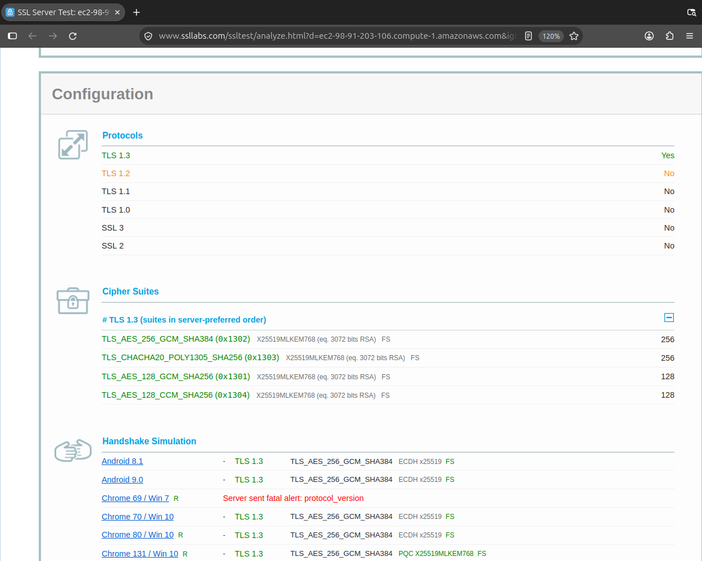

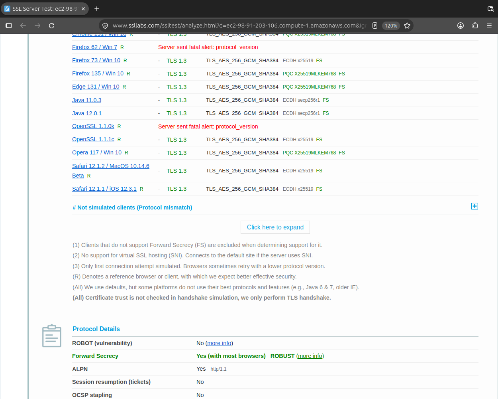

**Una diferencia que no cuadra: la reanudación.** La [[fig-3-6]] dice `Session resumption (tickets): No` para Act2. Pero en la actividad 3.2 la captura de Firefox muestra una reanudación con PSK en ese mismo servidor, con `pre_shared_key` en el `Client Hello` y sin `Certificate`. Una prueba directa lo confirma:

<!-- file: terminal -->
<!-- caption: reanudación de sesión contra Act2 con `s_client` -->
```bash
printf 'GET / HTTP/1.0\r\n\r\n' | openssl s_client -connect 98.91.203.106:443 \
  -servername web.protocolos.test -tls1_3 -CAfile lab/ca_actividad1.crt \
  -sess_out sesion.pem -quiet >/dev/null
printf 'GET / HTTP/1.0\r\n\r\n' | openssl s_client -connect 98.91.203.106:443 \
  -servername web.protocolos.test -tls1_3 -CAfile lab/ca_actividad1.crt \
  -sess_in sesion.pem 2>&1 | grep -E 'Reused|Verification'
```

<!-- caption: salida de la segunda conexión -->
```txt
Verification: OK
Reused, TLSv1.3, Cipher is TLS_AES_256_GCM_SHA384
```

El servidor sí reanuda. La explicación probable es que la prueba de reanudación de SSL Labs no contempla bien un servidor que solo admite TLS 1.3, donde el ticket llega después del handshake como mensaje cifrado. No se ha comprobado cómo hace la prueba SSL Labs. Lo que sí se comprobó es que la fila de la figura no describe lo que hace el servidor. Para Act1 la API de SSL Labs sí informa soporte de tickets (campo `sessionTickets`).

<!-- caption: resumen de SSL Labs para los dos servidores -->
| Aspecto | Act1 (TLS 1.2) | Act2 (TLS 1.3) |
|---|---|---|
| Nota | T (B ignorando la confianza) | T (A ignorando la confianza) |
| Protocolos | TLS 1.2 | TLS 1.3 |
| Suites | 15, siete marcadas `WEAK` (CBC) | 4, ninguna marcada |
| Intercambio de claves | ECDHE x25519 y DHE 2048. Sin grupos poscuánticos | `X25519MLKEM768` preferido. `x25519` y `secp256r1` con clientes sin híbrido |
| Secreto perfecto hacia adelante | Sí | Sí |
| Reanudación (tickets) | Sí | `No` en el informe, pero el servidor reanuda (arriba) |
| HSTS y OCSP stapling | No | No |
| Clientes simulados que fallan | 16 de 68 (muy antiguos: IE 6 a 10, Android 4.3 o anterior, Java 6 y 7, Safari 5 y 6) | 54 de 68 (todos los que no admiten TLS 1.3) |

### SSL Labs: cliente (Firefox 158.0)

La [[fig-3-7]] muestra el resultado del test del cliente. SSL Labs identifica el agente de usuario `Firefox/158.0` y concluye "Your user agent has good protocol support": admite TLS 1.2 y TLS 1.3. Las pruebas CurveBall, Logjam, FREAK y POODLE salen sin vulnerabilidad. El test se abrió con el perfil independiente de Firefox de la actividad 3.2, que es el mismo navegador.

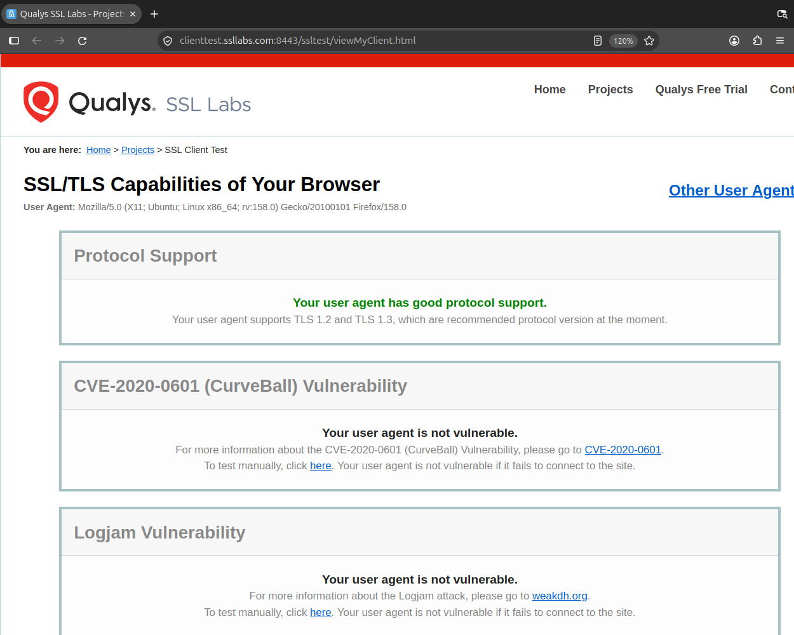

La [[fig-3-8]] muestra los protocolos y las suites que ofrece el navegador. TLS 1.3 y TLS 1.2 figuran como "Yes". TLS 1.1, TLS 1.0, SSL 3 y SSL 2 figuran como "No". Las suites van en orden de preferencia: primero las de TLS 1.3 (`0x1301`, `0x1303`, `0x1302`) y después las de TLS 1.2 con ECDHE. Es el mismo orden del `Client Hello` capturado en la actividad 3.2.

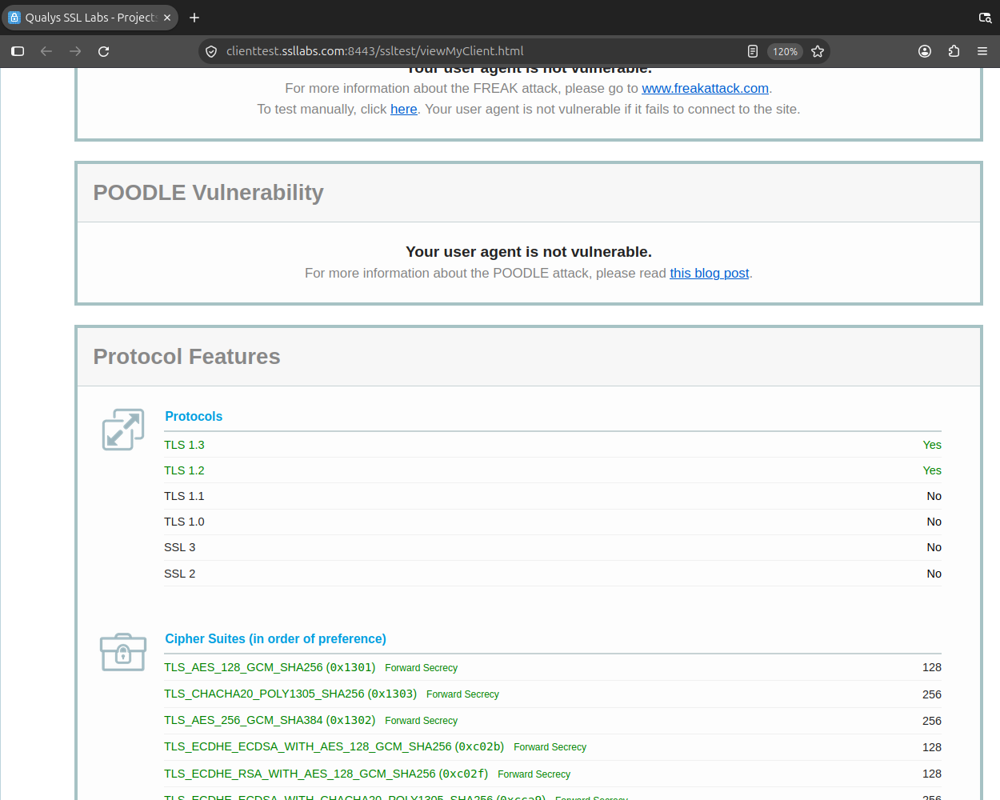

### testssl.sh

La [[fig-3-9]] muestra los protocolos de Act1. SSLv2, SSLv3, TLS 1.0 y TLS 1.1 no se ofrecen. TLS 1.2 se ofrece. Para TLS 1.3 dice `not offered and downgraded to a weaker protocol`. No significa un ataque ni que el cliente baje por su cuenta: `testssl.sh` envía un `Client Hello` de TLS 1.3 y el servidor contesta con TLS 1.2, la mejor versión que admite. Es una negociación de versión normal. ALPN anuncia `http/1.1`.

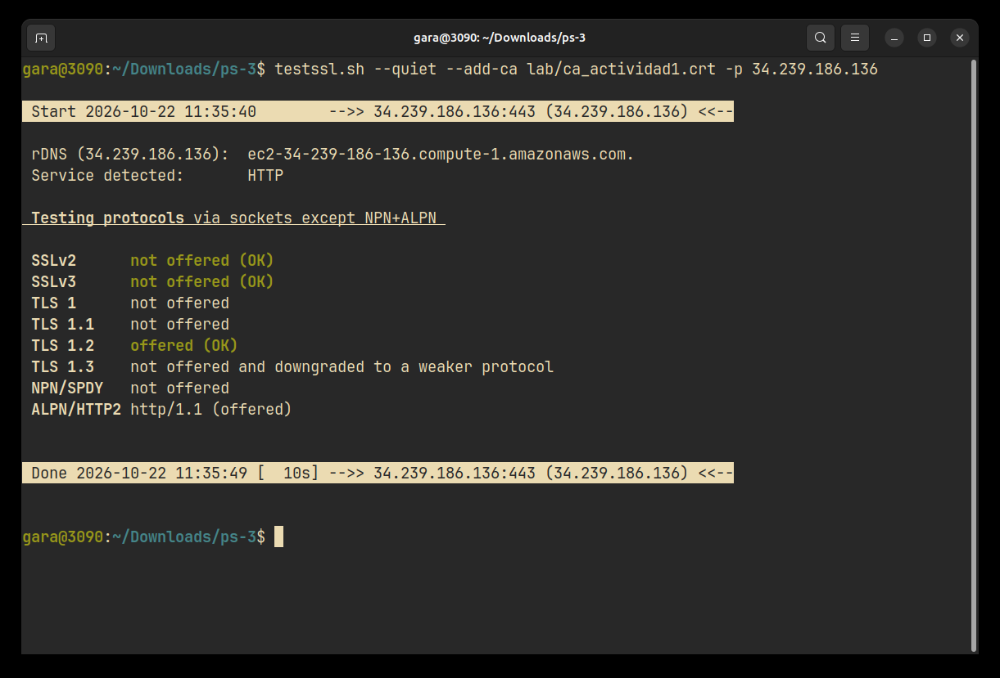

La [[fig-3-10]] muestra Act2. Aquí solo se ofrece TLS 1.3. `testssl.sh` detectó que el servidor admitía solo TLS 1.3 y cambió por sí mismo del OpenSSL que lleva incluido al `/usr/bin/openssl` del sistema, porque el incluido es antiguo y no habla TLS 1.3. Esta figura solo usa `-p` y no enumera suites. Las suites salen con `-P`, que muestra la elección del servidor ([[fig-3-12]] y [[fig-3-13]]).

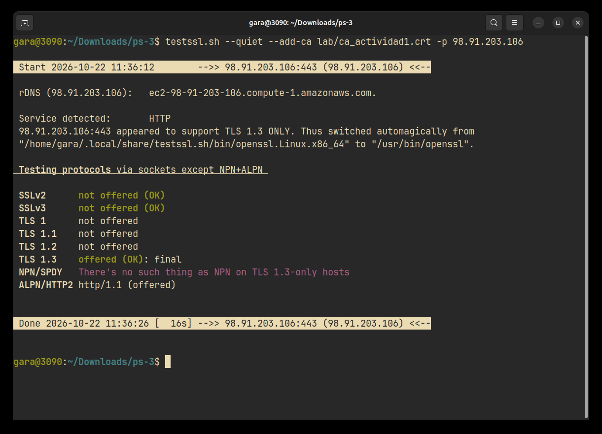

La [[fig-3-11]] muestra los valores por defecto del servidor de Act1. Hay un certificado, con clave RSA de 2048 bits y firma `SHA256 with RSA`. El nombre `web.protocolos.test` está en el CN y en el SAN. `Trust (hostname)` marca `certificate does not match supplied URI` en rojo, porque se analizó por IP y no por ese nombre. `Chain of trust` sale `Ok` gracias a `--add-ca` con la CA de la práctica. Faltan CRL y OCSP, el engrapado OCSP no se ofrece y no hay registro CAA en el DNS. Los tickets de sesión llevan una indicación de 300 segundos y la reanudación funciona con tickets y con identificador de sesión.

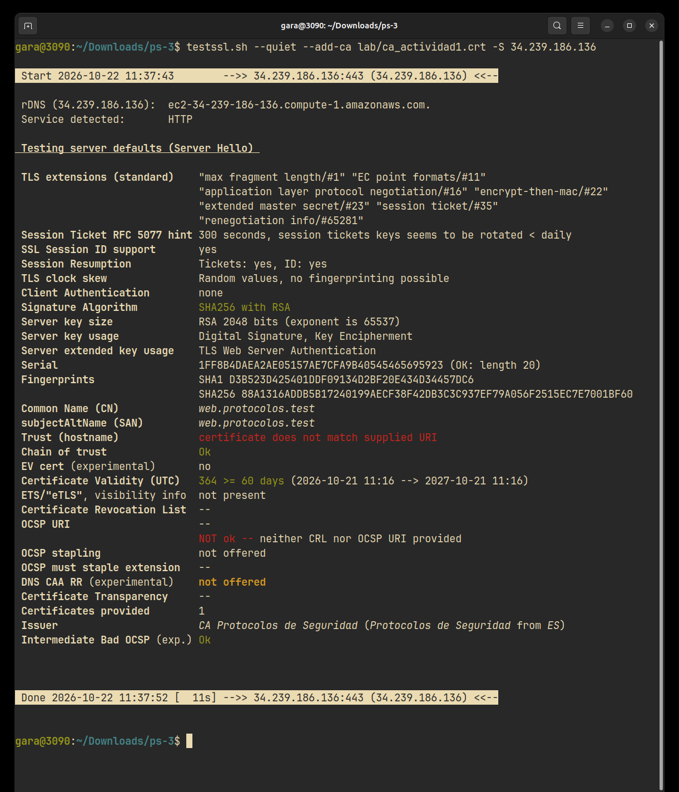

La opción `-P` enumera las suites en el orden que elige el servidor. La [[fig-3-12]] muestra las 15 suites de Act1, todas de TLS 1.2: seis con ECDHE (tres con CBC) y nueve con DHE de 2048 bits (cuatro con CBC). Aparecen en el mismo orden que en SSL Labs. La [[fig-3-13]] muestra las cuatro suites de Act2, todas de TLS 1.3 y con el intercambio marcado como `ECDH/MLKEM`. En la ejecución completa, `testssl.sh` también lista los grupos híbridos que acepta Act2 (`KEMs offered`: `SecP256r1MLKEM768`, `X25519MLKEM768` y `SecP384r1MLKEM1024`).


Las ejecuciones anteriores usaban opciones sueltas y no daban nota. La ejecución completa sí la da. Se lanzó con el nombre `web.protocolos.test` (`--ip` fija la dirección) para que el nombre coincida con el certificado. Solo se muestran las últimas líneas. La [[fig-3-14]] y la [[fig-3-15]] dan **A** a los dos servidores, con 93 puntos, y como único límite que no hay HSTS. En la misma ejecución completa `testssl.sh` informa, en los dos servidores: Heartbleed `not vulnerable`, ROBOT `Server does not support any cipher suites that use RSA key transport`, CRIME `not vulnerable`, `Strict Transport Security not offered`, `OCSP stapling not offered` y `Certificates provided 1`. `curl -sI` confirma que ninguno envía la cabecera `Strict-Transport-Security`.

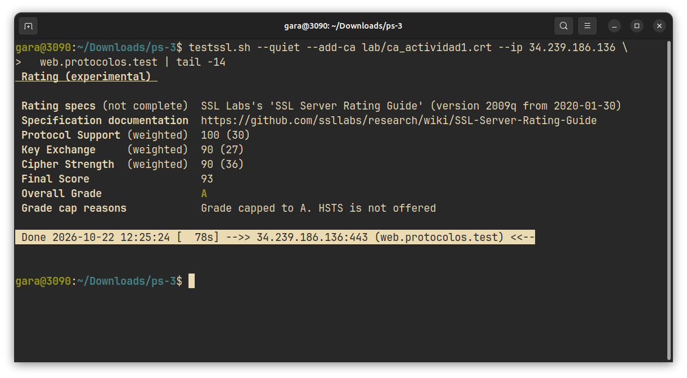

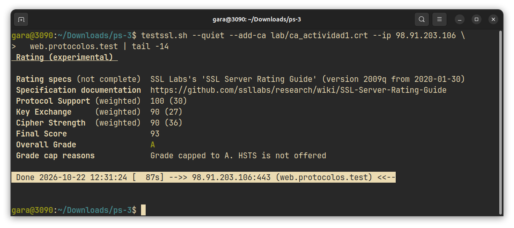

Esto responde a la comparación directa con SSL Labs. `testssl.sh` aplica la misma guía de puntuación (versión 2009q) y da A a Act1, donde SSL Labs da T (B ignorando la confianza). La diferencia es la cadena: con `--add-ca`, `testssl.sh` conoce la CA de la práctica y la cadena sale `Ok`, mientras que SSL Labs la ve incompleta. SSL Labs da A a Act2 ignorando la confianza, igual que `testssl.sh`. Por eso Act1 es el único servidor donde las dos herramientas no coinciden en la nota.

### Nmap con `ssl-enum-ciphers`

La [[fig-3-16]] muestra Act1. El script lista las 15 suites de TLS 1.2 en el mismo orden que SSL Labs y `testssl.sh`, con el intercambio entre paréntesis: `ecdh_x25519` o `dh 2048`. Califica todas con **A**, también las de CBC, y resume `least strength: A`. La compresión es `NULL` y la preferencia de suite es del servidor.

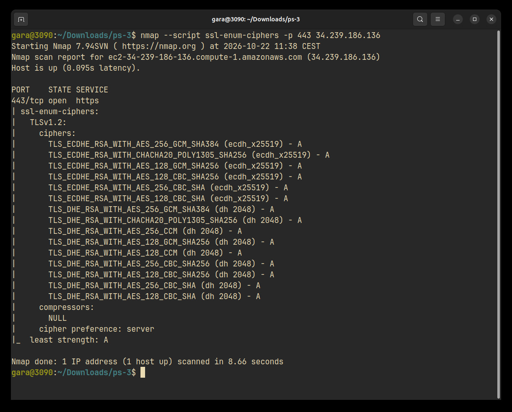

La [[fig-3-17]] muestra Act2. Lista las cuatro suites de TLS 1.3 con el prefijo `TLS_AKE_WITH_...`, todas con A y con el intercambio `ecdh_x25519`. Nmap no muestra la parte poscuántica del intercambio, y no es un problema de visualización: Nmap no ofrece el grupo híbrido en su `Client Hello`, así que el servidor negocia `x25519` con él. Se comprobó capturando el `Client Hello` de Nmap contra un `s_server` local:

<!-- caption: grupos del `Client Hello` de Nmap y de Firefox (de `tshark`, campo `supported_group`) -->
```txt
Nmap:     0x0017 0x0018 0x0019 0x001d 0x0100
          secp256r1, secp384r1, secp521r1, x25519, ffdhe2048
Firefox:  0x11ec 0x001d 0x0017 0x0018 0x0019
          X25519MLKEM768, x25519, secp256r1, secp384r1, secp521r1
```

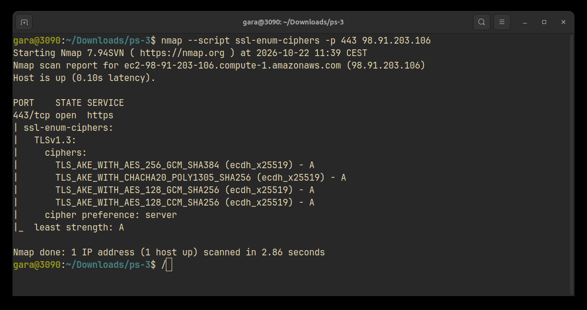

### Comparación de resultados

Las tres herramientas coinciden en lo básico: Act1 acepta solo TLS 1.2 con 15 suites en el mismo orden ([[fig-3-2]], [[fig-3-12]] y [[fig-3-16]]), y Act2 acepta solo TLS 1.3 con 4 suites. También coinciden con las pruebas de las actividades 3.1 y 3.2.

<!-- caption: comparación de las herramientas -->
| Aspecto | SSL Labs | `testssl.sh` | Nmap `ssl-enum-ciphers` |
|---|---|---|---|
| Dónde se ejecuta | Servicio de Qualys, desde Internet | En el equipo local | En el equipo local |
| Requisito | Servidor accesible desde Internet y nombre de host | Solo llegar al puerto | Solo llegar al puerto |
| Nota global | Sí (T, o B y A ignorando la confianza) | Sí, en la ejecución completa (A y A) | No. Una letra por suite y el mínimo |
| Certificado y confianza | Lo evalúa y limita la nota | Lo evalúa. Se le puede dar una CA propia (`--add-ca`) | No lo evalúa con este script |
| Suites débiles | Marca `WEAK` las siete de CBC | Las lista con su intercambio | Todas con A |
| Intercambio poscuántico | Muestra `X25519MLKEM768` | Muestra `ECDH/MLKEM` y los grupos híbridos | No lo ofrece en su `Client Hello`: solo ve `ecdh_x25519` |
| Vulnerabilidades | Lista extensa (Heartbleed, POODLE, ROBOT...) | Módulos propios (Heartbleed, ROBOT, CRIME...), en la ejecución completa | No es su función |
| Cliente | Sí, con el test del navegador | No | No |
| Simulación de clientes | Sí | No | No |
| Tiempo observado | 48 s (Act1) y 26 s (Act2), según el campo `duration` de la API | De 16 s con `-p` a unos 80 s la ejecución completa | De 3 a 9 segundos por servidor |

**Diferencias con el análisis de SSL Labs.**

- **La nota.** SSL Labs castiga con la letra T que el certificado no sea de confianza. `testssl.sh` dio `Ok` a la cadena porque se le entregó la CA de la práctica, y puntuó A a los dos servidores. Nmap no evalúa el certificado. SSL Labs ofrece además la nota que obtendría sin ese problema: B para Act1 y A para Act2. La causa de la B no es la cadena ni las suites CBC (véase el experimento arriba).
- **Las suites con CBC.** SSL Labs las marca como `WEAK`, pero esa marca no explica la nota de Act1: con todas las suites CBC retiradas la nota siguió en B. Nmap las califica con A. Los criterios son distintos: Nmap califica cada suite por la fortaleza del intercambio de claves y del cifrado, sin contar el hash ni la versión de TLS [9], y SSL Labs señala como débil el modo CBC.
- **El intercambio poscuántico.** SSL Labs y `testssl.sh` reconocen `X25519MLKEM768`. Nmap solo informa `ecdh_x25519` porque no ofrece el grupo híbrido: el servidor negocia `x25519` con él y no hay nada más que mostrar. Wireshark 4.2, en la actividad 3.2, es otro caso: sí vio el grupo en el `key_share`, pero no conoce su nombre y lo etiquetó como `Unknown`. Una herramienta que no ofrece el grupo y otra que no lo nombra dan imágenes incompletas por motivos distintos.
- **Por qué Act1 no ofrece intercambio poscuántico.** El grupo híbrido solo existe dentro del `key_share` de TLS 1.3. Act1 solo admite TLS 1.2, que no tiene ese mecanismo, así que no puede ofrecerlo con ningún ajuste aparte. SSL Labs lo avisa (`does not support PQC key exchange`) por esa razón.
- **El alcance.** Solo SSL Labs prueba el cliente y simula navegadores. Los otros dos auditan servidores.
- **La disponibilidad.** SSL Labs necesita llegar al servidor desde Internet, así que los grupos de seguridad de AWS deben permitir el puerto 443 desde Internet. `testssl.sh` y Nmap funcionan igual dentro de una red privada.

**Mejoras que proponen las auditorías.** Son recomendaciones para producción. En esta práctica Act1 se deja solo en TLS 1.2 a propósito, para comparar las dos versiones.

- **Act1:** activar TLS 1.3 además de TLS 1.2 (`SSLProtocol` por defecto) y retirar las suites con CBC. El experimento muestra que, por sí solas, estas dos medidas no suben la nota de SSL Labs.
- **Los dos servidores:** activar HSTS (`Strict-Transport-Security`). Falta en Act1 y en Act2, y es lo único que limita la nota A de `testssl.sh`.
- **Los dos servidores:** usar un certificado de una CA pública para eliminar la nota T. Hace falta un dominio real: `web.protocolos.test` usa el TLD reservado `.test` [12, §6.2] y ninguna CA pública emite certificados para él. Con el certificado público, el servidor debe enviar también el intermedio, para que la cadena deje de estar incompleta.
- **OCSP stapling:** con la CA gratuita habitual ya no es una recomendación realista. Let's Encrypt apagó su servicio OCSP el 6 de agosto de 2025 y publica la revocación solo con listas CRL [13]. El stapling solo tiene sentido con una CA que siga ofreciendo OCSP.

## Referencias

[1] P. Heinlein, "OpenSSL Command-Line HOWTO", *madboa.com*, act. 3-may-2024. [En línea]. Disponible: <https://www.madboa.com/geek/openssl/>. Apartados usados: versión de OpenSSL, benchmark de conexiones remotas, certificado autofirmado, conexión con SNI y servidor SSL desde la línea de comandos. [Accedido: 21-oct-2026].

[2] The Apache Software Foundation, "Apache Module mod_ssl: SSLProtocol", *Apache HTTP Server Version 2.4 Documentation*. [En línea]. Disponible: <https://httpd.apache.org/docs/2.4/mod/mod_ssl.html#sslprotocol>. [Accedido: 22-oct-2026].

[3] "TLS", *Wireshark Wiki* (apartados sobre `SSLKEYLOGFILE` y `editcap --inject-secrets`). [En línea]. Disponible: <https://wiki.wireshark.org/TLS>. [Accedido: 22-oct-2026].

[4] T. Dierks y E. Rescorla, "The Transport Layer Security (TLS) Protocol Version 1.2", RFC 5246, IETF, ago. 2008. [En línea]. Disponible: <https://www.rfc-editor.org/rfc/rfc5246>. [Accedido: 22-oct-2026].

[5] J. Salowey, H. Zhou, P. Eronen y H. Tschofenig, "Transport Layer Security (TLS) Session Resumption without Server-Side State", RFC 5077, IETF, ene. 2008. [En línea]. Disponible: <https://www.rfc-editor.org/rfc/rfc5077>. [Accedido: 22-oct-2026].

[6] The Apache Software Foundation, "Apache Core Features: KeepAliveTimeout", *Apache HTTP Server Version 2.4 Documentation*. [En línea]. Disponible: <https://httpd.apache.org/docs/2.4/mod/core.html#keepalivetimeout>. [Accedido: 22-oct-2026].

[7] E. Rescorla, "The Transport Layer Security (TLS) Protocol Version 1.3", RFC 8446, IETF, ago. 2018. [En línea]. Disponible: <https://www.rfc-editor.org/rfc/rfc8446>. [Accedido: 22-oct-2026].

[8] K. Kwiatkowski, P. Kampanakis, B. E. Westerbaan y D. Stebila, "Post-Quantum Traditional (PQ/T) Hybrid Key Agreement Mechanisms for TLS 1.3", RFC 10024, IETF, 2026. [En línea]. Disponible: <https://www.rfc-editor.org/rfc/rfc10024>. [Accedido: 22-oct-2026].

[9] Nmap Project, "ssl-enum-ciphers NSE script", *Nmap Scripting Engine Documentation*. [En línea]. Disponible: <https://nmap.org/nsedoc/scripts/ssl-enum-ciphers.html>. [Accedido: 22-oct-2026].

[10] Qualys SSL Labs, "SSL Server Rating Guide", versión 2009r (16-may-2025), *SSL Labs Research Wiki*. [En línea]. Disponible: <https://github.com/ssllabs/research/wiki/SSL-Server-Rating-Guide>. [Accedido: 22-oct-2026].

[11] Qualys SSL Labs, "SSL Labs API v3 Documentation", *ssllabs-scan*, GitHub. [En línea]. Disponible: <https://github.com/ssllabs/ssllabs-scan/blob/master/ssllabs-api-docs-v3.md>. [Accedido: 22-oct-2026].

[12] M. Cotton y L. Vegoda, "Special-Use Domain Names", RFC 6761, IETF, feb. 2013. [En línea]. Disponible: <https://www.rfc-editor.org/rfc/rfc6761>. [Accedido: 22-oct-2026].

[13] Let's Encrypt, "OCSP Service Has Reached End of Life", 6-ago-2025. [En línea]. Disponible: <https://letsencrypt.org/2025/08/06/ocsp-service-has-reached-end-of-life>. [Accedido: 22-oct-2026].
