## Actividad 4.1: Servidor SSH

## Actividad 4.2: fail2ban

fail2ban lee los registros de un servicio y cuenta los fallos de cada IP. Cuando una IP llega a `maxretry` fallos dentro de `findtime` segundos, la bloquea en el cortafuegos durante `bantime` segundos [1].

### Entorno

Las pruebas se hicieron el 5 de noviembre de 2026 con las dos instancias de AWS del Tema 3.

<!-- caption: equipos de la prueba -->
| Papel | Equipo | Sistema | IP pública |
|---|---|---|---|
| Servidor | Act1 (`JavierDiboAct1`) | RHEL 10.2 | 184.198.103.83 |
| Atacante | Act2 (`JavierDiboAct2`) | RHEL 10.2 | 3.90.46.118 |
| Administrador | Portátil | Ubuntu | 207.188.144.145 |

En Act1, `sshd` solo acepta claves públicas. La instancia no tiene `firewalld` ni `iptables`, así que el bloqueo se hace con `nftables`.

### Instalación

fail2ban no está en los repositorios de RHEL. Sale de EPEL 10 [2]. Se instala el paquete `fail2ban-server` y no el metapaquete `fail2ban`, que arrastra también `firewalld` y `sendmail`. `fail2ban-selinux` entra como dependencia.

<!-- file: terminal -->
<!-- caption: instalación de fail2ban en Act1 -->
```bash
sudo dnf install -y https://dl.fedoraproject.org/pub/epel/epel-release-latest-10.noarch.rpm
sudo dnf install -y fail2ban-server
sudo systemctl enable --now fail2ban
```

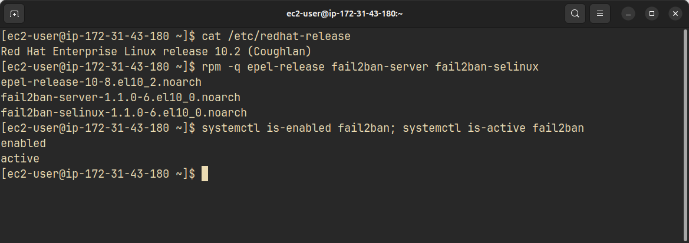

### Configuración

`jail.conf` trae los valores por defecto y no se edita, porque una actualización lo sobrescribe. Los cambios van en `jail.local`, que fail2ban lee después [1].

<!-- caption: configuración de fail2ban en Act1 -->
<!-- file: /etc/fail2ban/jail.local -->
```ini
[DEFAULT]
bantime   = 300
findtime  = 600
maxretry  = 5
banaction = nftables-multiport
banaction_allports = nftables-allports
ignoreip  = 127.0.0.1/8 ::1 207.188.144.145

[sshd]
enabled = true
backend = systemd
```

<!-- caption: directivas de jail.local -->
| Directiva | Valor | Efecto |
|---|---|---|
| `maxretry` | 5 | Fallos que provocan el bloqueo |
| `findtime` | 600 | Ventana, en segundos, en la que se cuentan los fallos |
| `bantime` | 300 | Duración del bloqueo, en segundos |
| `banaction` | `nftables-multiport` | Bloquea los puertos de la jaula. `jail.conf` usa `iptables-multiport`, que no existe en Act1 |
| `banaction_allports` | `nftables-allports` | La misma sustitución para las jaulas que bloquean todos los puertos |
| `ignoreip` | `127.0.0.1/8 ::1 207.188.144.145` | IP que nunca se bloquean. Incluye el portátil, para no perder el acceso por un error |
| `enabled` | `true` | Activa la jaula `sshd` |
| `backend` | `systemd` | Lee los mensajes de `sshd` en el journal de systemd, y no en un archivo de log |

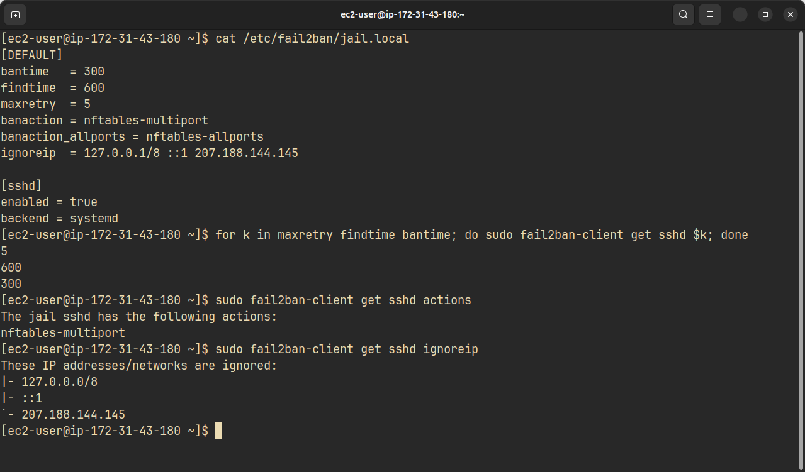

### Modo del filtro `sshd`

El filtro `sshd` tiene varios modos [3]. La jaula usa `normal`, el modo por defecto.

<!-- caption: modos normal y aggressive del filtro sshd -->
| | `normal` | `aggressive` |
|---|---|---|
| Conexión con un usuario que no existe | 1 fallo (`Invalid user`) | 2 fallos (también `Connection closed … [preauth]`) |
| Bloqueo con `maxretry = 5` | En la 5.ª conexión | En la 3.ª conexión |
| Conexión con un usuario real sin la clave correcta | No cuenta | Cuenta (`Connection closed … [preauth]`) |
| Escaneos sin autenticación (`Did not receive identification string`) | No cuenta | Cuenta |

En `normal`, la línea `Connection closed … [preauth]` lleva la marca `<F-NOFAIL>`: identifica la IP, pero no suma un fallo [3]. Un usuario real sin la clave correcta no puede entrar, porque el servidor no acepta contraseñas. Por eso el modo `normal` basta en Act1, y cada conexión del atacante cuenta exactamente un fallo.

### Ataque y bloqueo

Desde Act2 se lanzan 6 conexiones seguidas con un usuario que no existe. `BatchMode=yes` evita que `ssh` pida nada.

<!-- file: terminal -->
<!-- caption: ataque desde Act2 -->
```bash
for i in 1 2 3 4 5 6; do
echo "Intento $i, $(date +%T)"; ssh -o BatchMode=yes -o ConnectTimeout=5 atacante@184.198.103.83
sleep 1; done
```

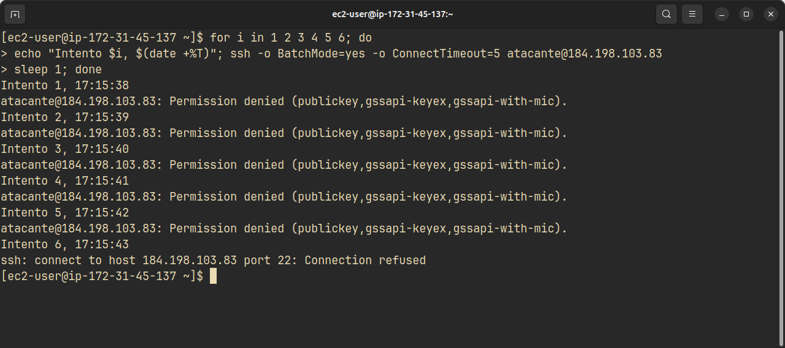

Los 5 primeros intentos llegan a `sshd` y fallan en la autenticación. El quinto fallo provoca el bloqueo, y el 6.º intento ya no llega al servicio: `nftables` rechaza el paquete con un ICMP `port-unreachable`, que el cliente muestra como `Connection refused`.

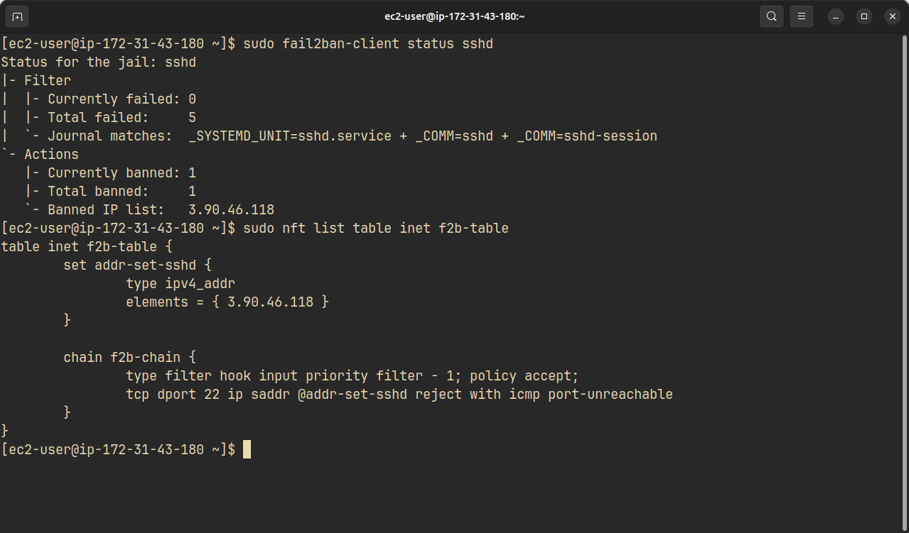

La acción `nftables-multiport` crea la tabla `inet f2b-table` [4]. El conjunto `addr-set-sshd` guarda las IP bloqueadas, y la cadena `f2b-chain` rechaza el puerto 22 para esas IP. La regla solo afecta al puerto de la jaula: el resto de servicios de Act1 sigue accesible para el atacante.

Durante el bloqueo, el portátil entra en Act1 sin problemas, porque su IP está en `ignoreip`.

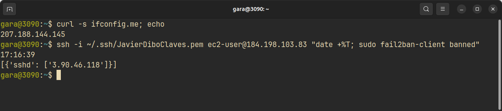

### Desbloqueo

A los 300 s, fail2ban saca la IP del conjunto. Un intento nuevo desde Act2 vuelve a llegar a `sshd`, y recibe otra vez `Permission denied`.

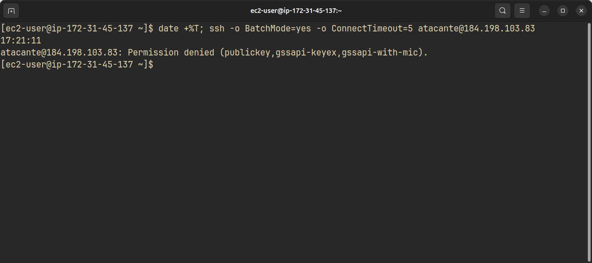

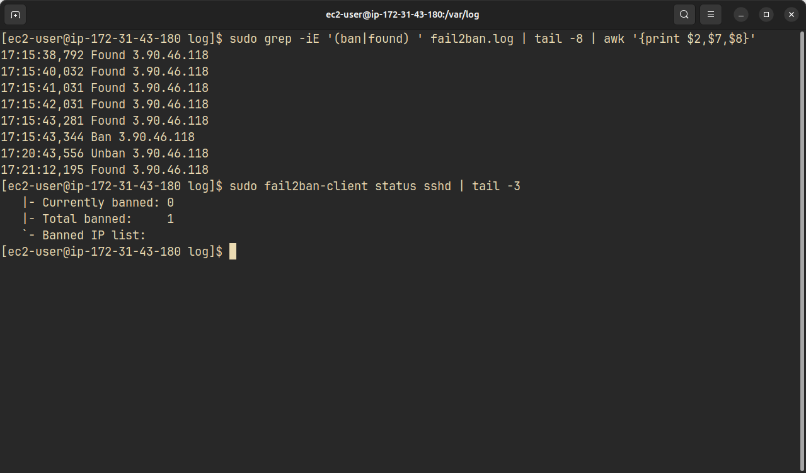

<!-- caption: cronología del registro de fail2ban -->
| Hora | Evento |
|---|---|
| 17:15:38,792 a 17:15:43,281 | 5 fallos (`Found`) de 3.90.46.118 |
| 17:15:43,344 | `Ban`, 63 ms después del quinto fallo |
| 17:20:43,556 | `Unban`, 300 s después del bloqueo |
| 17:21:12,195 | `Found` del intento nuevo |

Los 5 fallos caen en 4,5 s, muy dentro de los 600 s de `findtime`. Tras el desbloqueo, `Currently banned` vuelve a 0 y `Total banned` queda en 1.

### Bots de Internet

Un servidor SSH con una IP pública recibe intentos de bots que prueban usuarios y contraseñas. La misma jaula los bloquearía igual que a Act2. Durante la prueba no llegó ninguno: el registro de fail2ban y el journal de `sshd` solo contienen las IP de Act2 y del portátil, y el único bloqueo fue el de Act2.

### Mejoras sin activar

Dos opciones de fail2ban endurecen el bloqueo de una IP que reincide [1]. No se activan, porque cambian los 300 s que pide el enunciado.

- **`bantime.increment = true`**: cada bloqueo nuevo de la misma IP dura más que el anterior. Con `bantime.factor` y `bantime.maxtime` se controla el crecimiento y el máximo.
- **La jaula `recidive`**: lee el propio registro de fail2ban. Una IP bloqueada varias veces en un periodo largo recibe un bloqueo largo en todos los puertos, con la acción de `banaction_allports`.

<!-- caption: ejemplo de las dos mejoras (no aplicado) -->
```ini
[DEFAULT]
bantime.increment = true
bantime.factor    = 2
bantime.maxtime   = 1w

[recidive]
enabled  = true
logpath  = /var/log/fail2ban.log
bantime  = 1w
findtime = 1d
maxretry = 3
```

## Actividad 4.3: CheckTLS

CheckTLS TestReceiver [5] se conecta a los servidores de correo (MX) de un dominio y comprueba la sesión SMTP con STARTTLS [6]: la versión de TLS, el cifrado y el certificado de cada MX.

### Cuentas analizadas

<!-- caption: dominios analizados -->
| Cuenta | Dominio | Motivo |
|---|---|---|
| Correo limpio | `gmail.com` | Proveedor grande con certificados de una CA pública |
| Correo con deficiencias | `mailinator.com` | Correo desechable. Sus MX usan certificados autofirmados |

La cuenta de la Universidad de Jaén no aporta nada distinto: sus MX son los de Google, los mismos que analiza `gmail.com`. El test solo necesita el dominio, así que no se envía ninguna dirección personal.

### Bloqueo de la prueba en el navegador

La página no devuelve resultados en el navegador. Al pulsar *Run Test*, el campo del dominio se marca en rojo, la sección *Test Results* queda vacía y aparece el aviso: "To try CheckTLS without a subscription please turn off tracking prevention and ad blocking so we can count your tests."

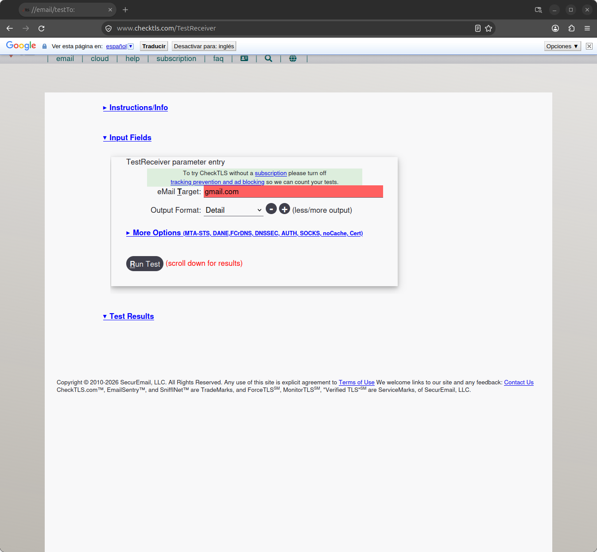

Se probó en dos navegadores de escritorio y en un móvil con datos móviles, fuera de la red de casa, con el mismo resultado. La versión con los parámetros en la URL tampoco funciona sin cuenta: responde "Use of CheckTLS web services requires COMPANYCODE and COMPANYPASS".

### Método

El resultado se obtiene enviando el mismo formulario con `curl`. La primera petición descarga la página, con su cookie y su `csrf_token`. La segunda envía el formulario con el dominio y el formato *Detail* (`LEVEL=4`), como haría el botón *Run Test*.

<!-- file: terminal -->
<!-- caption: envío del formulario de TestReceiver con curl -->
```bash
for d in gmail.com mailinator.com; do
  curl -s -c cj -b cj -A 'Mozilla/5.0' https://www.checktls.com/TestReceiver -o form.html
  tok=$(grep -oP 'name="csrf_token" value="\K[^"]*' form.html)
  curl -s -c cj -b cj -A 'Mozilla/5.0' -e https://www.checktls.com/TestReceiver \
    --data-urlencode "csrf_token=$tok" --data-urlencode EMAIL=$d \
    -d LEVEL=4 -d PROGRESS=off -d QUICK=off \
    https://www.checktls.com/TestReceiver -o ${d%%.*}.html --max-time 170
done
```

La respuesta es la página de CheckTLS con la sección *Test Results* completa. Las figuras de esta actividad son esa página, abierta en Firefox con la hoja de estilos de CheckTLS. El texto completo de cada resultado está en `lab/checktls-gmail.txt` y `lab/checktls-mailinator.txt`.

### Resultado de Gmail

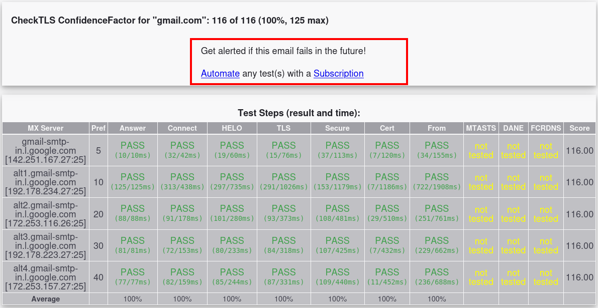

Los 5 MX de Gmail pasan todas las comprobaciones, con 116 puntos cada uno. La [[fig-3-3]] muestra el detalle del MX principal. La sesión negocia TLS 1.3 con `TLS_AES_256_GCM_SHA384` y secreto perfecto hacia delante. El certificado es válido (`Cert VALIDATED: ok`), lo emite Google Trust Services (WE2) y su `subjectAltName` incluye `gmail-smtp-in.l.google.com`. Tras STARTTLS, el segundo `EHLO` ya no anuncia `STARTTLS`.

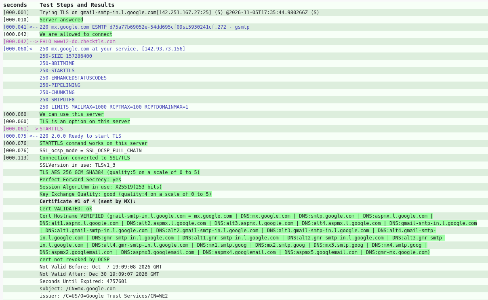

Las columnas MTA-STS [7], DANE [8] y FCrDNS salen como *not tested*. Son comprobaciones de *More Options* que el test no activa por defecto.

### Resultado de Mailinator

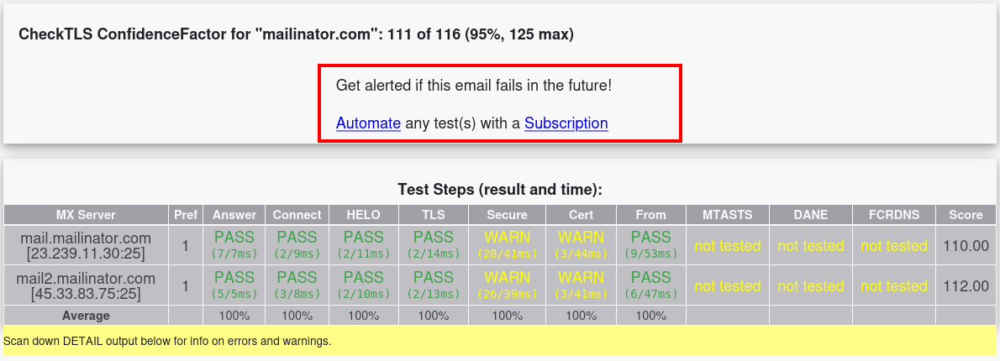

Los 2 MX de Mailinator conectan y cifran con TLS 1.3, pero fallan la validación del certificado. Las columnas *Secure* y *Cert* dan WARN.

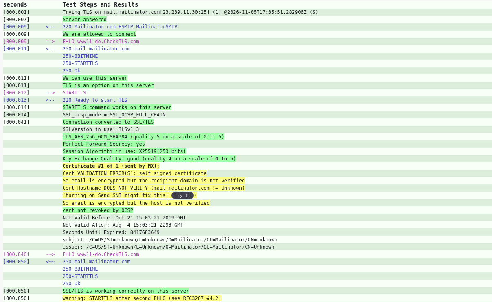

`mail.mailinator.com` presenta un certificado autofirmado (`Cert VALIDATION ERROR(S): self signed certificate`) con `CN=Unknown`. El nombre no coincide con el del servidor (`Cert Hostname DOES NOT VERIFY`). El certificado es válido de 2019 a 2293, un periodo que ninguna CA pública emite.

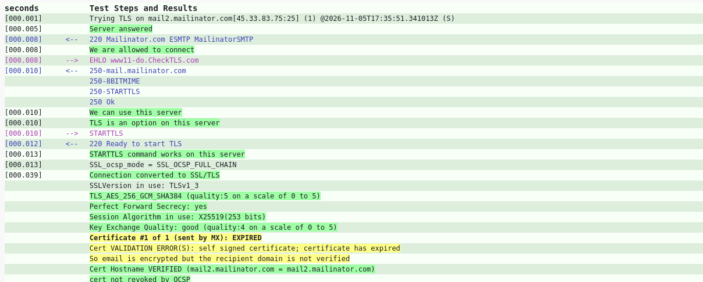

`mail2.mailinator.com` presenta otro certificado autofirmado, que además caducó el 23 de marzo de 2025 (`certificate has expired`). En este caso el nombre sí coincide.

CheckTLS resume las dos situaciones igual: "So email is encrypted but the recipient domain is not verified". El correo viaja cifrado, pero el emisor no puede saber si habla con el servidor real de Mailinator o con un intermediario. Un atacante en la ruta puede presentar su propio certificado autofirmado sin que el emisor note la diferencia.

Los dos MX tienen otro aviso: `warning: STARTTLS after second EHLO (see RFC3207 #4.2)`. El servidor vuelve a anunciar `STARTTLS` en la respuesta al `EHLO` que sigue al handshake, y la RFC 3207 lo prohíbe [6, §4.2].

### Comparación

<!-- caption: comparación de gmail.com y mailinator.com en CheckTLS -->
| | `gmail.com` | `mailinator.com` |
|---|---|---|
| ConfidenceFactor | 116 de 116 (100 %) | 111 de 116 (95 %) |
| MX analizados | 5 | 2 |
| Versión de TLS | TLS 1.3 | TLS 1.3 |
| Cifrado | `TLS_AES_256_GCM_SHA384` | `TLS_AES_256_GCM_SHA384` |
| Emisor del certificado | Google Trust Services | El propio servidor (autofirmado) |
| Validación del certificado | Correcta | Error en los 2 MX |
| Nombre del certificado | Coincide | No coincide en `mail`, coincide en `mail2` |
| Caducidad | En vigor | `mail2` caducado desde el 23-mar-2025 |
| `STARTTLS` tras el segundo `EHLO` | No | Sí, en los 2 MX |

El cifrado de las dos sesiones es idéntico. La diferencia está en la autenticación del servidor: Gmail prueba su identidad con una cadena de confianza pública, y Mailinator no puede probarla. La puntuación solo baja 5 puntos, pero la deficiencia es seria. Con STARTTLS oportunista, la mayoría de los emisores SMTP aceptan un certificado no válido, así que no detectan a un intermediario [8].

## Referencias

[1] The Fail2Ban Project, "jail.conf", *fail2ban*, GitHub. [En línea]. Disponible: <https://github.com/fail2ban/fail2ban/blob/master/config/jail.conf>. [Accedido: 5-nov-2026].

[2] Fedora Project, "Extra Packages for Enterprise Linux (EPEL)", *Fedora Docs*. [En línea]. Disponible: <https://docs.fedoraproject.org/en-US/epel/>. [Accedido: 5-nov-2026].

[3] The Fail2Ban Project, "filter.d/sshd.conf", *fail2ban* 1.1.0, GitHub. [En línea]. Disponible: <https://github.com/fail2ban/fail2ban/blob/master/config/filter.d/sshd.conf>. [Accedido: 5-nov-2026].

[4] The Fail2Ban Project, "action.d/nftables.conf", *fail2ban*, GitHub. [En línea]. Disponible: <https://github.com/fail2ban/fail2ban/blob/master/config/action.d/nftables.conf>. [Accedido: 5-nov-2026].

[5] SecurEmail, LLC, "CheckTLS TestReceiver". [En línea]. Disponible: <https://www.checktls.com/TestReceiver>. [Accedido: 5-nov-2026].

[6] P. Hoffman, "SMTP Service Extension for Secure SMTP over Transport Layer Security", RFC 3207, IETF, feb. 2002. [En línea]. Disponible: <https://www.rfc-editor.org/rfc/rfc3207>. [Accedido: 5-nov-2026].

[7] D. Margolis, M. Risher, B. Ramakrishnan, A. Brotman y J. Jones, "SMTP MTA Strict Transport Security (MTA-STS)", RFC 8461, IETF, sep. 2018. [En línea]. Disponible: <https://www.rfc-editor.org/rfc/rfc8461>. [Accedido: 5-nov-2026].

[8] V. Dukhovni y W. Hardaker, "SMTP Security via Opportunistic DNS-Based Authentication of Named Entities (DANE) Transport Layer Security (TLS)", RFC 7672, IETF, oct. 2015. [En línea]. Disponible: <https://www.rfc-editor.org/rfc/rfc7672>. [Accedido: 5-nov-2026].
