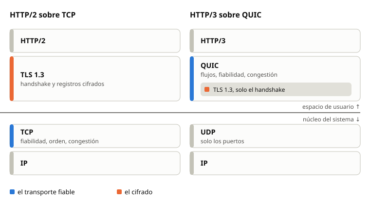
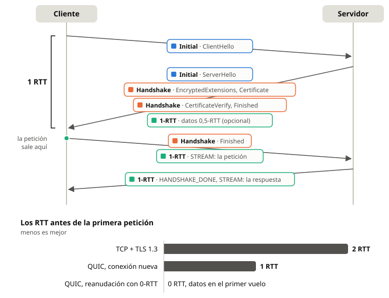
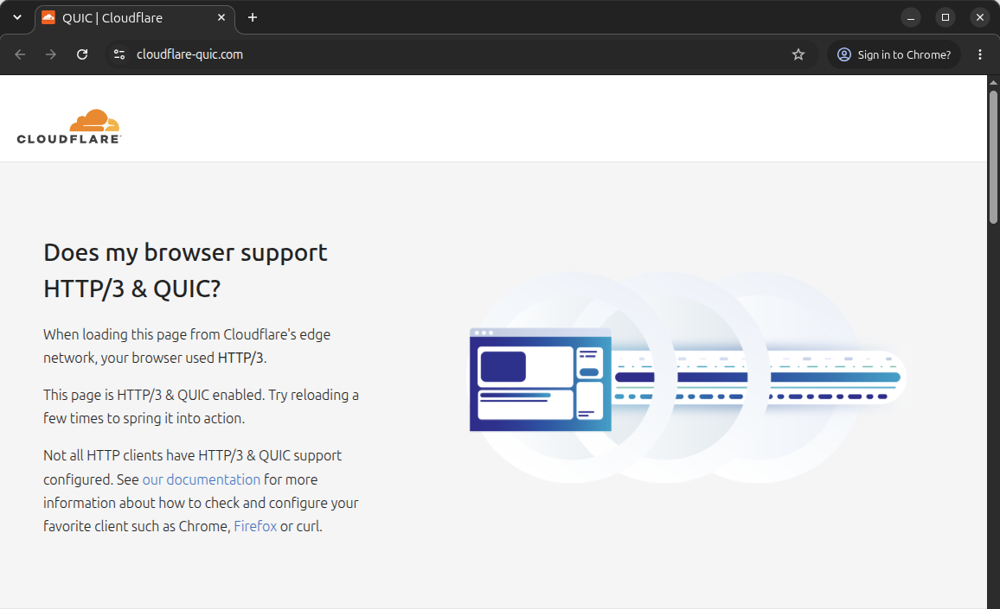
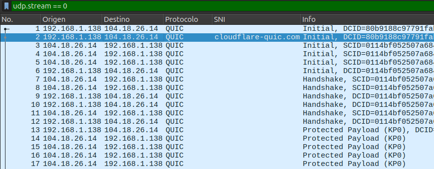
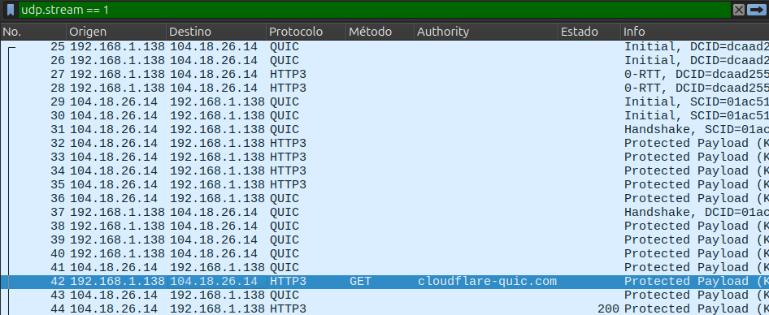

<!-- _class: portada -->
<!-- _paginate: false -->
<!-- _footer: "" -->

# QUIC

Un protocolo de transporte cifrado sobre UDP

Miguel Bolívar García y Javier Francisco Dibo Gómez
Protocolos de Seguridad · 2026/2027

---

## ¿Qué es QUIC?

- Un protocolo de **transporte** sobre **UDP**: entrega fiable, control de flujo y de congestión, como TCP
- **Cifrado obligatorio** con TLS 1.3: no existe QUIC sin cifrar
- Muchos **flujos independientes** en una conexión
- La conexión **sobrevive a un cambio de red** (Wi-Fi → 4G)

Google, 2012 (gQUIC) → IETF, 2016 → **RFC 9000 / 9001 / 9002**, mayo de 2021
**HTTP/3** (RFC 9114) funciona sobre QUIC

---

## El problema que resuelve

- **Bloqueo en cabeza de línea**: en HTTP/2 sobre TCP, un segmento perdido detiene *todas* las peticiones
- **Dos negociaciones**: TCP + TLS 1.3 = 2 RTT antes del primer dato
- **Osificación**: TCP vive en el núcleo, y los *middleboxes* rompen cualquier extensión nueva

QUIC: en el espacio de usuario, sobre UDP, y con la cabecera cifrada

---

## HTTP/2 frente a HTTP/3

---

## Arquitectura

- **Connection ID**: identifica la conexión, no la IP ni el puerto → migración
- **Paquetes** con cabecera larga (`Initial`, `0-RTT`, `Handshake`, `Retry`) o corta (`1-RTT`)
- **Tramas** dentro de cada paquete: `STREAM`, `ACK`, `CRYPTO`, `MAX_DATA`, `PATH_CHALLENGE`…
- **Flujos** uni o bidireccionales: una pérdida detiene solo su flujo
- **Números de paquete** que nunca se repiten: el RTT se mide sin ambigüedad

---

## Handshake: 1 RTT (o 0-RTT)

Transporte y TLS 1.3 en **una sola negociación**, con los mensajes de TLS en tramas `CRYPTO`.

---

## Seguridad: TLS 1.3 integrado

| Nivel | Claves derivadas de |
|---|---|
| Initial | Connection ID del cliente + sal fija → **solo ofuscación** |
| 0-RTT | PSK de una sesión anterior |
| Handshake | (EC)DHE de TLS 1.3 |
| 1-RTT | Secreto de aplicación de TLS 1.3 |

- AEAD por paquete: AES-GCM o ChaCha20-Poly1305
- **Secreto perfecto hacia adelante** desde el nivel Handshake
- **Actualización de claves** con el bit *Key Phase*

---

## Seguridad: la cabecera y los parámetros

- **Protección de la cabecera**: una máscara oculta el número de paquete
  → un observador no ve las pérdidas ni las retransmisiones
- **Parámetros de transporte** dentro del handshake de TLS → autenticados
- Los Connection ID se repiten en los parámetros → detecta su inyección
- **ALPN obligatorio** (`h3`)

---

## Seguridad: amplificación y suplantación

UDP no verifica el origen → riesgo de **ataques de amplificación**

- El servidor envía **≤ 3×** lo que recibió hasta validar al cliente
- El primer datagrama del cliente lleva **≥ 1200 bytes**
- **`Retry` + token**: el cliente demuestra su dirección, el servidor no guarda estado
- **Migración**: `PATH_CHALLENGE` / `PATH_RESPONSE` + Connection ID nuevo → no se enlaza el tráfico
- **Stateless reset** con un token de 16 bytes acordado antes

---

## Puntos débiles

- **`Initial` legible**: cualquiera ve el `ClientHello` y el SNI (la solución es ECH)
- **0-RTT**: sin secreto hacia adelante y **repetible** → solo peticiones idempotentes (`425 Too Early`)
- **Metadatos visibles**: IP, puertos, tamaños, tiempos, Connection ID, *spin bit*
- **Opacidad**: un cortafuegos no inspecciona QUIC → muchas empresas bloquean UDP 443

---

## Aplicaciones

- **HTTP/3**: Chrome, Firefox, Safari; Google, Meta, Cloudflare
- **DNS sobre QUIC** (RFC 9250)
- **MASQUE** (RFC 9298): iCloud Private Relay, Cloudflare WARP
- **SMB sobre QUIC**: archivos de Windows Server sin VPN
- **WebTransport**: flujos y datagramas en el navegador

Implementaciones: quiche (Google, Cloudflare), msquic, ngtcp2, quic-go, aioquic

---

## Demostración

1. Chrome abre `cloudflare-quic.com` con HTTP/3 y guarda sus claves en `SSLKEYLOGFILE`
2. Wireshark **sin claves**: el `Initial` con el SNI se lee; el resto es `Protected Payload`
3. Wireshark **con claves**: la petición y la respuesta HTTP/3

Sin ECH: con ECH, el SNI es `cloudflare-ech.com` y Wireshark no descifra nada

---

## Sin claves: el SNI en claro

2: el SNI `cloudflare-quic.com` en claro · desde el 13: `Protected Payload`

---

## Con claves: la reanudación

27 y 28: **0-RTT** en el primer vuelo · 42: `GET` · 44: `200`

---

## Conclusiones

- QUIC lleva el transporte al espacio de usuario y **hace del cifrado parte del transporte**
- Menos latencia, sin bloqueo entre flujos, y conexiones que cambian de red
- Defensas de diseño contra amplificación, suplantación y manipulación
- Límites conocidos: `Initial` ofuscado, repetición del 0-RTT, inspección difícil

**¿Preguntas?**
