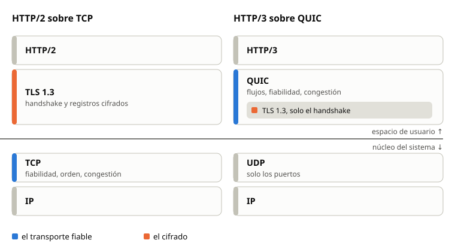
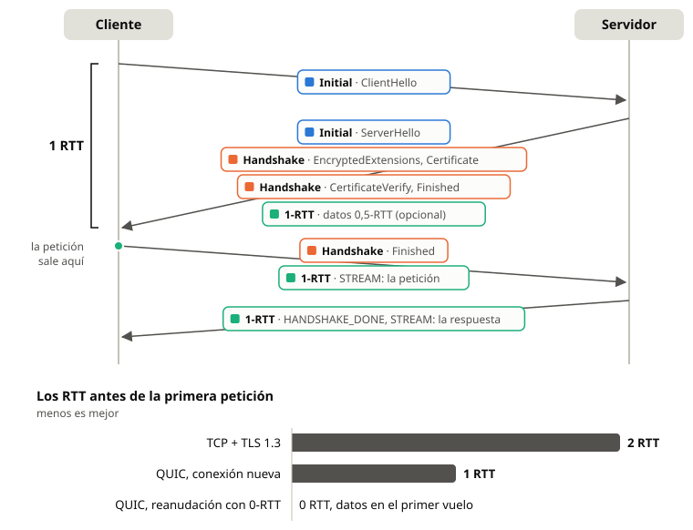
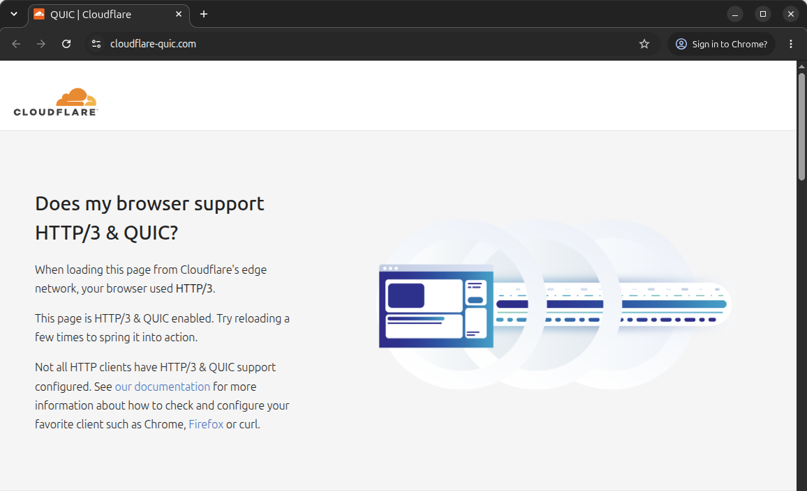
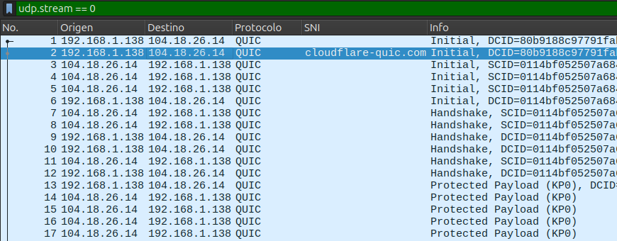
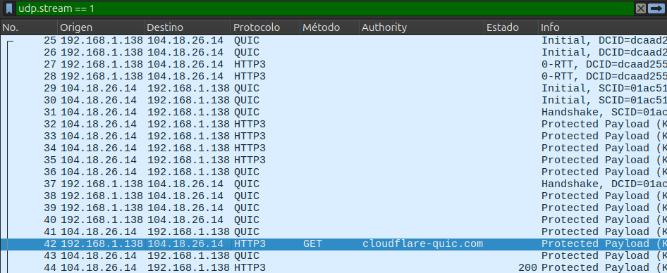

## Introducción

QUIC es un protocolo de transporte de propósito general que funciona sobre UDP. Ofrece lo mismo que TCP (entrega fiable y ordenada, control de flujo y control de congestión), pero añade tres cosas: el cifrado obligatorio con TLS 1.3, varios flujos independientes dentro de una conexión y la migración de la conexión entre redes [1].

### Origen

Google diseñó QUIC en 2012 y lo desplegó en Chrome y en sus servidores a partir de 2013. Esa primera versión, conocida hoy como gQUIC, usaba un protocolo criptográfico propio (QUIC Crypto). En 2016 el IETF creó un grupo de trabajo para estandarizarlo, y sustituyó QUIC Crypto por el handshake de TLS 1.3. El resultado se publicó en mayo de 2021:

<!-- caption: los RFC del núcleo de QUIC -->
| RFC | Contenido |
|---|---|
| RFC 8999 | Propiedades invariantes de QUIC, comunes a todas las versiones [2] |
| RFC 9000 | El protocolo de transporte [1] |
| RFC 9001 | La protección de QUIC con TLS [3] |
| RFC 9002 | La detección de pérdidas y el control de congestión [4] |

HTTP/3 (RFC 9114, junio de 2022) es la versión de HTTP que funciona sobre QUIC [5].

### El problema que resuelve

HTTP/2 multiplexa muchas peticiones sobre una sola conexión TCP. TCP entrega un único flujo de bytes en orden, así que un segmento perdido detiene la entrega de todas las peticiones hasta que llega la retransmisión. Este efecto se llama bloqueo en cabeza de línea (*head-of-line blocking*).

Además, una conexión segura sobre TCP necesita dos negociaciones seguidas: el *three-way handshake* de TCP y después el handshake de TLS. Con TLS 1.3 son 2 RTT (viajes de ida y vuelta) antes del primer byte de la aplicación.

Cambiar TCP es muy difícil. TCP vive en el núcleo del sistema operativo, y muchos *middleboxes* (cortafuegos, NAT, balanceadores) inspeccionan y reescriben sus cabeceras. Una extensión nueva de TCP rompe en cuanto un equipo intermedio no la entiende. Este fenómeno se llama osificación. QUIC evita el problema con dos decisiones: funciona sobre UDP, que todos los equipos dejan pasar, y cifra casi toda su cabecera, así que ningún equipo intermedio puede depender de ella.

## Arquitectura

### Posición en la pila

QUIC se implementa en el espacio de usuario, como una biblioteca de la aplicación, y no en el núcleo. Una aplicación puede actualizar QUIC con la misma frecuencia que el resto de su código.



### Conexiones e identificadores de conexión

TCP identifica una conexión con la cuaterna de direcciones y puertos. QUIC la identifica con identificadores de conexión (*Connection ID*) que elige cada extremo. Un paquete llega a su conexión aunque cambien la IP o el puerto del cliente, por ejemplo al pasar de una red Wi-Fi a la red móvil o tras un cambio de NAT.

### Paquetes y tramas

Un datagrama UDP lleva uno o varios paquetes QUIC, y cada paquete lleva una o varias tramas (*frames*). Hay dos formatos de cabecera:

- **Cabecera larga**: se usa durante el establecimiento. Sus tipos son `Initial`, `0-RTT`, `Handshake` y `Retry`. Lleva la versión y los dos Connection ID.
- **Cabecera corta**: se usa después del handshake, para los paquetes `1-RTT`. Solo lleva el Connection ID de destino, el número de paquete y unos pocos bits.

Algunas tramas importantes son `STREAM` (datos de un flujo), `ACK` (confirmaciones), `CRYPTO` (mensajes del handshake de TLS), `MAX_DATA` y `MAX_STREAM_DATA` (control de flujo), `NEW_CONNECTION_ID`, `PATH_CHALLENGE` y `PATH_RESPONSE` (migración) y `CONNECTION_CLOSE`.

### Flujos

Una conexión tiene muchos flujos (*streams*) independientes. Cada flujo es unidireccional o bidireccional, y lo abre el cliente o el servidor. Los dos bits bajos del identificador del flujo codifican esas dos propiedades. Un paquete perdido detiene solo los flujos cuyos datos llevaba. Los demás flujos siguen entregando datos a la aplicación.

### Fiabilidad y congestión

QUIC nunca reutiliza un número de paquete. Una retransmisión envía los datos perdidos en un paquete nuevo, con un número nuevo. Así el emisor sabe siempre qué paquete confirma cada `ACK`, y mide el RTT sin la ambigüedad de TCP [4]. Las tramas `ACK` pueden confirmar muchos rangos de paquetes a la vez.

El RFC 9002 describe un control de congestión parecido a NewReno. Las implementaciones reales usan también CUBIC o BBR, porque el algoritmo vive en la aplicación y se puede cambiar sin tocar el sistema operativo.

### El establecimiento de la conexión

QUIC junta el handshake de transporte y el de TLS 1.3 en uno solo. Una conexión nueva envía datos de la aplicación tras 1 RTT:



Un cliente que ya conoce al servidor puede reanudar la sesión y enviar datos en el primer vuelo, en paquetes `0-RTT`.

## Elementos de seguridad

### TLS 1.3 integrado

QUIC no usa los registros (*records*) de TLS. Usa TLS 1.3 solo para el handshake: los mensajes de TLS viajan en tramas `CRYPTO`, y TLS entrega a QUIC las claves de cada nivel de cifrado [3]. QUIC cifra después cada paquete con su propio esquema AEAD (cifrado autenticado), con las suites de TLS 1.3: AES-128-GCM, AES-256-GCM o ChaCha20-Poly1305.

Hay cuatro niveles de cifrado, cada uno con sus claves:

<!-- caption: los niveles de cifrado de QUIC -->
| Nivel | Paquetes | Origen de las claves |
|---|---|---|
| Initial | `Initial` | El Connection ID de destino del cliente y una sal fija de la versión |
| 0-RTT | `0-RTT` | La clave precompartida (PSK) de una sesión anterior |
| Handshake | `Handshake` | El intercambio de claves (EC)DHE de TLS 1.3 |
| 1-RTT | cabecera corta | El secreto de aplicación de TLS 1.3 |

Las consecuencias para la seguridad son estas:

- **QUIC no tiene modo sin cifrar.** Todos los paquetes llevan cifrado y autenticación, salvo `Version Negotiation`, `Retry` y el reinicio sin estado.
- **Las claves `Initial` no dan confidencialidad.** Cualquier observador lee el Connection ID y calcula las mismas claves. Las claves `Initial` solo protegen contra la manipulación por atacantes que no ven el tráfico. Por eso Wireshark muestra el `ClientHello`, y con él el SNI (el nombre del servidor), sin ninguna clave. Encrypted Client Hello (ECH) resuelve esto igual que en TLS sobre TCP.
- **Secreto perfecto hacia adelante.** Las claves `Handshake` y `1-RTT` salen del intercambio (EC)DHE. Una filtración posterior de la clave privada del servidor no descifra el tráfico grabado.
- **Actualización de claves.** El bit *Key Phase* de la cabecera corta indica la generación de la clave. Un extremo cambia la clave de una conexión larga sin un handshake nuevo.

### Protección de la cabecera

QUIC cifra también una parte de la cabecera. Toma una muestra del texto cifrado del paquete, calcula una máscara (con AES-ECB o con ChaCha20) y la aplica al número de paquete y a algunos bits del primer byte [3]. Un observador no ve el número de paquete, así que no puede seguir las retransmisiones ni las pérdidas de una conexión. La parte de la cabecera que queda en claro también está autenticada por el AEAD.

### Parámetros de transporte autenticados

Cada extremo anuncia sus parámetros de transporte (límites de flujo, tiempos, Connection ID...) en una extensión del handshake de TLS (`quic_transport_parameters`). El handshake autentica esa extensión, así que un atacante no puede cambiar los límites. Dos de esos parámetros repiten los Connection ID del establecimiento (`original_destination_connection_id` e `initial_source_connection_id`). Con ellos el cliente detecta un atacante que inyecta o cambia identificadores durante el handshake [1].

QUIC exige además ALPN: los dos extremos acuerdan el protocolo de la aplicación (por ejemplo `h3` para HTTP/3) dentro del handshake.

### Defensas contra la amplificación y la suplantación

UDP no comprueba la dirección de origen. Un atacante puede enviar un paquete pequeño con la IP de una víctima, y el servidor responde a la víctima con un paquete grande. QUIC tiene tres defensas [1]:

- **Límite de amplificación.** Antes de validar la dirección del cliente, el servidor envía como mucho 3 veces los bytes que recibió.
- **Relleno del primer paquete.** El cliente rellena (*padding*) cada datagrama con un paquete `Initial` hasta 1200 bytes como mínimo. Así el servidor tiene margen para responder con su certificado.
- **Paquete `Retry`.** Un servidor bajo carga responde con un `Retry`, que lleva un token. El cliente repite su `Initial` con ese token y demuestra que recibe en esa dirección. El servidor no guarda estado hasta entonces. El servidor también puede dar un token con la trama `NEW_TOKEN` para la próxima conexión.

### Migración y validación de caminos

Cuando un paquete llega desde una dirección nueva, el extremo valida el camino: envía una trama `PATH_CHALLENGE` con 8 bytes aleatorios, y espera la misma cifra en `PATH_RESPONSE`. Hasta que el camino queda validado, el límite de amplificación se aplica también a la dirección nueva. Así un atacante no usa la migración para dirigir tráfico a una víctima.

Cada extremo entrega al otro varios Connection ID con `NEW_CONNECTION_ID`. Al migrar, el cliente usa un identificador nuevo. Un observador de las dos redes no puede relacionar el tráfico de antes y el de después por el identificador.

### Reinicio sin estado

Un servidor que pierde el estado de una conexión (por ejemplo tras reiniciarse) no puede enviar un `CONNECTION_CLOSE` cifrado. Envía un *stateless reset*: un paquete que parece normal y termina con un token de 16 bytes. El token se acordó antes por un canal cifrado, así que solo el extremo legítimo puede cerrar la conexión así.

### El riesgo del 0-RTT

Los datos `0-RTT` no tienen secreto perfecto hacia adelante, porque dependen solo de la PSK. Además, un atacante puede grabar esos paquetes y reenviarlos (ataque de repetición o *replay*). Por eso una aplicación solo debe enviar en 0-RTT peticiones idempotentes, como un `GET`. Un servidor de HTTP puede rechazar una petición con el código `425 Too Early` [6].

### Otros ataques que el estándar considera

La sección 21 del RFC 9000 recoge más ataques y sus defensas [1]:

- **ACK optimista.** Un cliente confirma paquetes que no recibió para que el servidor envíe más rápido. El emisor puede saltar números de paquete: un `ACK` de un número que nunca envió delata el ataque.
- **Agotamiento de memoria.** Un atacante abre muchos flujos o envía datos con huecos para que el receptor los guarde. Los límites de `MAX_STREAMS` y de control de flujo acotan esa memoria.
- **Falsificación de peticiones.** Un atacante intenta que el servidor envíe paquetes a una dirección interna, con la migración o con la dirección preferida. La validación de caminos lo impide.

### Lo que sigue visible

QUIC cifra mucho, pero no todo. Un observador ve las direcciones IP y los puertos, el tamaño y el momento de cada paquete, los Connection ID y la versión de las cabeceras largas. El bit de giro (*spin bit*) es opcional: si el extremo lo activa, un observador puede medir el RTT de la conexión [1]. Para frenar la osificación, el RFC 9287 permite variar el bit fijo de la cabecera (*greasing*), y QUIC versión 2 (RFC 9369) cambia la sal y los números de tipo de paquete [7].

Esta opacidad tiene un coste para la seguridad de una red. Un cortafuegos no puede inspeccionar el tráfico QUIC como inspecciona TCP. Muchas empresas bloquean UDP 443, y entonces el navegador vuelve a HTTP/2 sobre TCP.

## Aplicaciones

### HTTP/3

HTTP/3 es la aplicación principal de QUIC [5]. Cada petición usa su propio flujo bidireccional, y la compresión de cabeceras QPACK (RFC 9204) sustituye a HPACK para no reintroducir el bloqueo en cabeza de línea. Un cliente descubre que un servidor admite HTTP/3 por la cabecera `Alt-Svc` de una respuesta anterior, o por un registro DNS de tipo `HTTPS`. Chrome, Firefox, Safari y Edge usan HTTP/3, igual que Google, Meta y Cloudflare en sus servidores.

### Otros protocolos sobre QUIC

- **DNS sobre QUIC (DoQ, RFC 9250)**: consultas DNS cifradas sin el bloqueo en cabeza de línea de DNS sobre TLS [8].
- **MASQUE (RFC 9298)**: túneles de UDP sobre HTTP/3. Apple iCloud Private Relay y Cloudflare WARP lo usan para ocultar la IP del usuario [9].
- **SMB sobre QUIC**: Windows Server comparte archivos por Internet sin VPN.
- **WebTransport**: una API del navegador para enviar flujos y datagramas sobre HTTP/3, con la extensión de datagramas no fiables (RFC 9221).

### Implementaciones

<!-- caption: algunas implementaciones de QUIC -->
| Implementación | Lenguaje | Usuario principal |
|---|---|---|
| quiche (Google) | C++ | Chrome y servidores de Google |
| quiche (Cloudflare) | Rust | Red de Cloudflare, curl |
| msquic | C | Windows, .NET |
| ngtcp2 | C | curl |
| quic-go | Go | Caddy |
| aioquic | Python | Pruebas y docencia |

### Demostración

La demostración abre `cloudflare-quic.com` en Chrome, captura el tráfico QUIC y lo abre en Wireshark. La página confirma que el navegador usa HTTP/3.



<!-- caption: Chrome guarda sus secretos de TLS, y dumpcap captura el tráfico QUIC -->
```bash
SSLKEYLOGFILE=$PWD/lab/claves.log google-chrome \
  --user-data-dir=/tmp/chrome-quic \
  --disable-features=EncryptedClientHello,UseDnsHttpsSvcb,AsyncDns \
  https://cloudflare-quic.com/ &
dumpcap -i any -f 'udp port 443' -w lab/quic.pcapng
```

Chrome usa ECH con Cloudflare: el SNI visible es `cloudflare-ech.com`, y Wireshark no descifra la conexión. Las opciones de `--disable-features` quitan ECH para la demostración. La captura tiene dos conexiones, una nueva y una reanudación, y Wireshark la abre en dos pasos:

1. **Sin claves.** Wireshark descifra los paquetes `Initial` sin ninguna clave y muestra el `ClientHello` con el SNI. El resto de paquetes sale como `Protected Payload`, y el número de paquete no aparece.
2. **Con claves.** El navegador escribe sus secretos de TLS en el archivo de `SSLKEYLOGFILE`. Wireshark lee ese archivo y muestra las tramas `STREAM` con la petición y la respuesta de HTTP/3.



En la reanudación, los paquetes 27 y 28 son `0-RTT` y salen en el primer vuelo, junto al `ClientHello`. Con las claves, el paquete 42 muestra la petición `GET` a `cloudflare-quic.com`, y el 44 la respuesta `200`.



El curl del sistema (8.5.0) no tiene soporte de HTTP/3, así que la demostración usa Chrome.

## Conclusiones

QUIC traslada el transporte del núcleo a la aplicación y hace del cifrado una parte del propio transporte. Gana latencia (1 RTT, o 0-RTT al reanudar), elimina el bloqueo en cabeza de línea entre flujos y mantiene la conexión al cambiar de red. En seguridad, todo el tráfico va autenticado y casi todo cifrado, incluida la cabecera, y el diseño incluye defensas contra la amplificación, la suplantación y la manipulación de los equipos intermedios. Sus puntos débiles son conocidos: los paquetes `Initial` solo están ofuscados, el 0-RTT admite repeticiones y su opacidad dificulta la inspección del tráfico en una red corporativa.

## Referencias

[1] J. Iyengar y M. Thomson, "QUIC: A UDP-Based Multiplexed and Secure Transport", RFC 9000, IETF, may. 2021. [En línea]. Disponible: <https://www.rfc-editor.org/rfc/rfc9000>.

[2] M. Thomson, "Version-Independent Properties of QUIC", RFC 8999, IETF, may. 2021. [En línea]. Disponible: <https://www.rfc-editor.org/rfc/rfc8999>.

[3] M. Thomson y S. Turner, "Using TLS to Secure QUIC", RFC 9001, IETF, may. 2021. [En línea]. Disponible: <https://www.rfc-editor.org/rfc/rfc9001>.

[4] J. Iyengar e I. Swett, "QUIC Loss Detection and Congestion Control", RFC 9002, IETF, may. 2021. [En línea]. Disponible: <https://www.rfc-editor.org/rfc/rfc9002>.

[5] M. Bishop, "HTTP/3", RFC 9114, IETF, jun. 2022. [En línea]. Disponible: <https://www.rfc-editor.org/rfc/rfc9114>.

[6] M. Thomson, M. Nottingham y W. Tarreau, "Using Early Data in HTTP", RFC 8470, IETF, sep. 2018. [En línea]. Disponible: <https://www.rfc-editor.org/rfc/rfc8470>.

[7] M. Duke, "QUIC Version 2", RFC 9369, IETF, may. 2023. [En línea]. Disponible: <https://www.rfc-editor.org/rfc/rfc9369>.

[8] C. Huitema, S. Dickinson y A. Mankin, "DNS over Dedicated QUIC Connections", RFC 9250, IETF, may. 2022. [En línea]. Disponible: <https://www.rfc-editor.org/rfc/rfc9250>.

[9] D. Schinazi, "Proxying UDP in HTTP", RFC 9298, IETF, ago. 2022. [En línea]. Disponible: <https://www.rfc-editor.org/rfc/rfc9298>.
