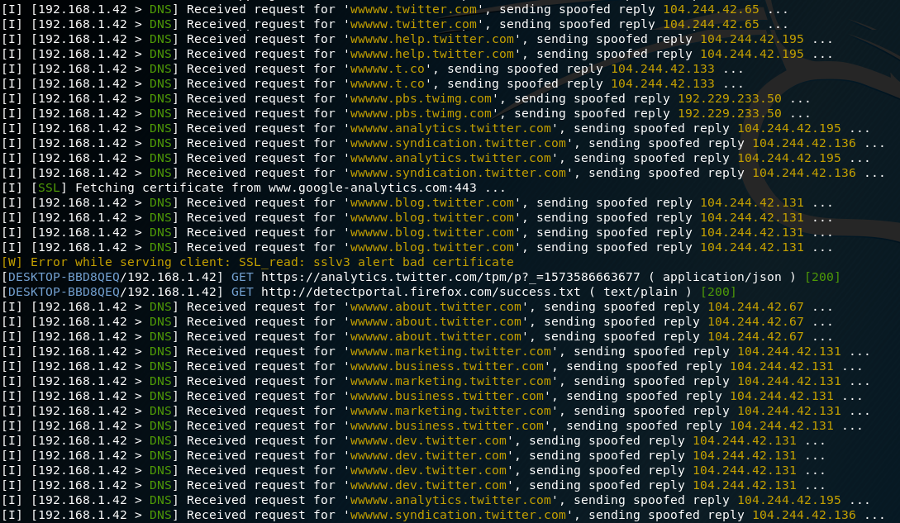
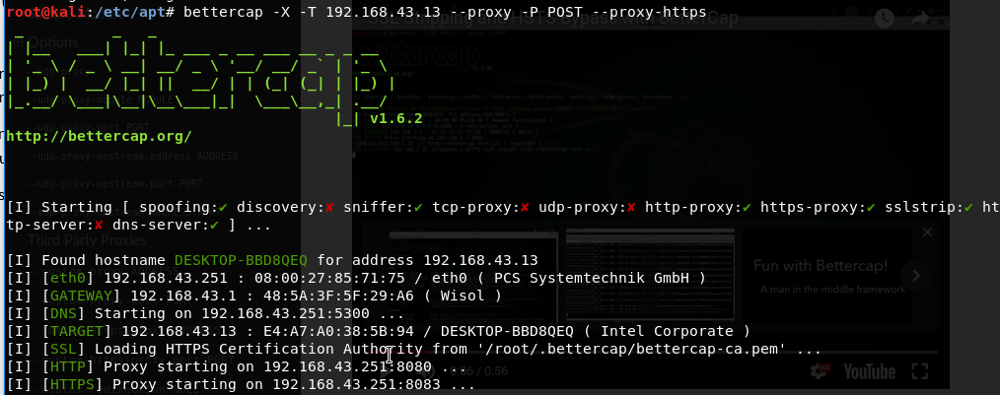

## Contexto

Un vecino hace un ataque Man-in-the-Middle (MitM) con bettercap 1.6.2, y se pone entre la víctima y los servidores. La víctima escribe cada dirección con `http://`, nunca con `https://`. Las capturas vienen del enunciado de la actividad. La salida de bettercap de la [[fig-6-1]] lleva la marca de tiempo `1573586663677`, el 12 de noviembre de 2019. Las respuestas no repiten el ataque. Lo explican con la especificación de HSTS [1], las listas de precarga de los navegadores de esa fecha y el código de bettercap 1.6.2 [2].

HSTS (HTTP Strict Transport Security) es la defensa de todas las preguntas. Un servidor envía la cabecera `Strict-Transport-Security` por HTTPS. Desde ese momento, el navegador cambia a HTTPS cada URL de ese host antes de enviarla [1, §8.3]. Si el certificado falla, el navegador corta la conexión y no deja continuar al usuario [1, §12.1]. El navegador conoce la política de un host de dos formas: por una visita anterior (HSTS dinámico) o por la lista de precarga que trae el propio navegador.

## Pregunta 1: Twitter en Chrome

**¿Por qué no he podido acceder a Twitter?** La [[fig-2-1]] muestra el error `NET::ERR_CERT_INVALID`. Chrome no pidió la página por HTTP. Abrió una conexión HTTPS con `twitter.com`, y bettercap respondió con un certificado falso, firmado por su propia autoridad de certificación (`bettercap-ca.pem`, en la [[fig-6-2]]). Chrome no confía en esa autoridad.

**¿Qué ha hecho el navegador?** La lista de precarga HSTS de Chrome de noviembre de 2019 incluye `twitter.com` con el modo `force-https` [3]. Por eso Chrome cambió `http://twitter.com` a `https://twitter.com` antes de enviar nada, y bettercap nunca vio una petición HTTP que pudiera reescribir. La página de error no ofrece el enlace para continuar al sitio, porque en un host HSTS el usuario no tiene esa opción [1, §12.1]. Chrome cortó la conexión antes de enviar ningún dato.

## Pregunta 2: BBVA en Chrome

La pregunta escribe `http://www.bbva.com`, y la captura muestra el dominio `bbva.es`. La explicación vale para los dos dominios.

**¿Por qué sí he podido acceder?** BBVA no está en la lista de precarga de Chrome [3], y la víctima no visitó el banco antes con ese navegador. Chrome no tenía ninguna política HSTS para el host, así que envió la primera petición por HTTP. El RFC 6797 reconoce esa debilidad del primer acceso [1, §14.6]: quien controla la red controla la primera respuesta.

**¿Qué ha hecho bettercap?** bettercap recibió la petición HTTP y la envió al servidor real. El servidor respondió con una redirección a HTTPS, y bettercap cambió esa redirección antes de pasarla a la víctima [2, `strip.rb`]:

1. Cambió `https://` por `http://`.
2. Cambió el host `www.bbva.es` por `wwwww.bbva.es`.
3. Añadió a su servidor DNS una regla que resuelve `wwwww.bbva.es` con la IP real de `www.bbva.es`.
4. Borró la cabecera `Strict-Transport-Security` de la respuesta.

Después, la víctima pide `http://wwwww.bbva.es`. bettercap deshace el cambio de host y pide la página al banco por HTTPS. La víctima ve la web del banco por HTTP, y la barra dice "No es seguro" ([[fig-3-1]]). Todo lo que la víctima escribe pasa en claro por el equipo del vecino.

**La diferencia con Twitter.** Chrome conocía la política de Twitter antes del ataque, y no conocía la de BBVA. Con Twitter, la primera petición salió por HTTPS. Con BBVA, salió por HTTP, y bettercap pudo reescribir la respuesta.

## Pregunta 3: BBVA en Chrome, después de una visita

**¿Por qué no he podido acceder?** El error de la [[fig-4-1]] es el mismo de la pregunta 1. Chrome abrió una conexión HTTPS, bettercap presentó su certificado falso, y Chrome cortó la conexión.

**¿Qué ha hecho el navegador?** En la visita anterior, sin ataque, `www.bbva.es` respondió por HTTPS con la cabecera `Strict-Transport-Security`. Chrome guardó esa política durante el tiempo de su `max-age` [1, §8.1]. Después, la víctima escribe `http://www.bbva.es`, y Chrome cambia la URL a HTTPS antes de enviarla [1, §8.3]. bettercap no recibe ninguna petición HTTP, así que no puede quitar el HTTPS ni cambiar el host. Solo le queda presentar un certificado falso, y HSTS no deja al usuario aceptarlo [1, §12.1].

**La diferencia con la pregunta 2.** El sitio es el mismo, y cambia el estado del navegador. En la pregunta 2, Chrome no tenía ninguna política para BBVA, y bettercap borraba la cabecera HSTS de cada respuesta. En la pregunta 3, Chrome tenía la política de una visita limpia. El resultado es el mismo de Twitter en la pregunta 1, pero la política tiene otro origen: la lista de precarga en Twitter, y la visita anterior (HSTS dinámico) en BBVA.

## Pregunta 4: Twitter en Firefox

**¿Por qué sí he podido acceder?** Firefox no aplicó ninguna política HSTS a `twitter.com`. Su primera petición salió por HTTP, y bettercap hizo el mismo ataque de la pregunta 2. En la [[fig-5-1]], el host es `wwwww.twitter.com` y el candado aparece tachado. La salida de bettercap de la [[fig-6-1]] confirma el navegador: la víctima pide `http://detectportal.firefox.com/success.txt`, la comprobación de portal cautivo de Firefox.

El Firefox de la víctima es nuevo, así que no tiene ninguna política dinámica. La única defensa posible era su lista de precarga. La lista de Firefox del 11 de noviembre de 2019 incluye `twitter.com` [4], así que un Firefox al día habría dado un error como el de la pregunta 1. La captura muestra que esa lista no actuó. Una causa compatible con la captura es una lista caducada. Firefox fija la caducidad de su lista 18 semanas después de generarla [5], y no consulta una lista caducada [6]. Un instalador antiguo trae una lista caducada, y ese Firefox no protege ningún host precargado.

**La diferencia con la pregunta 1.** El sitio y el ataque son los mismos, y cambia el navegador. Chrome traía `twitter.com` en una lista de precarga activa, y forzó HTTPS desde la primera petición. En Firefox, la lista no actuó, y no había ninguna visita anterior. Sin ninguna política HSTS, el primer acceso es igual que en la pregunta 2. La lista actual de Firefox incluye `twitter.com` con sus subdominios [7], así que un Firefox al día bloquea este ataque.

## Pregunta 5: la salida de bettercap

**¿Qué está haciendo bettercap?** La [[fig-6-2]] muestra el arranque. bettercap activa el *spoofing* ARP, que lo pone entre la víctima y la puerta de enlace. También activa el proxy HTTP, el proxy HTTPS, sslstrip y su propio servidor DNS, y carga su autoridad de certificación, `bettercap-ca.pem`.

La [[fig-6-1]] muestra el ataque a la víctima `192.168.1.42` (`DESKTOP-BBD8QEQ`). Cada tipo de línea es una acción:

- `[DNS] Received request for 'wwwww.twitter.com', sending spoofed reply 104.244.42.65`: la víctima pregunta por un host que no existe, y el servidor DNS de bettercap responde con la IP real de `twitter.com`. Lo mismo pasa con `wwwww.help.twitter.com`, `wwwww.t.co`, `wwwww.pbs.twimg.com` y los otros hosts de la página.
- `[SSL] Fetching certificate from www.google-analytics.com:443`: bettercap descarga el certificado real del sitio, para copiar sus datos en un certificado falso.
- `[W] Error while serving client: SSL_read: sslv3 alert bad certificate`: el navegador rechaza ese certificado falso en una conexión que salió directa por HTTPS. Es el fallo de las preguntas 1 y 3.
- `GET https://analytics.twitter.com/... [200]`: bettercap pide un recurso al servidor real por HTTPS, en nombre de la víctima, y registra la respuesta.
- `GET http://detectportal.firefox.com/success.txt`: Firefox comprueba si la red tiene un portal cautivo.

**¿Cómo logra evadir las defensas del navegador?** HSTS asocia cada política a un nombre de host exacto. La política cubre los subdominios solo con la directiva `includeSubDomains` [1, §6.1.2]. bettercap usa ese límite [2]:

1. Cambia `https://` por `http://` en los enlaces y en las redirecciones de cada respuesta.
2. Cambia el nombre del host: `www` pasa a `wwwww`, `mail` a `wmail`, `webmail` a `wwebmail` y `m` a `wmobile`. Otro host recibe el prefijo `wwwww.`, como `wwwww.help.twitter.com`.
3. Añade a su DNS una regla para el nombre nuevo, con la IP real del host original.
4. Recibe la petición de la víctima por HTTP, deshace el cambio de nombre y pide el recurso al servidor real por HTTPS.
5. Borra la cabecera `Strict-Transport-Security` de cada respuesta, para que la víctima no aprenda la política durante el ataque.

El navegador no tiene ninguna política para `wwwww.twitter.com`, y por eso acepta HTTP sin aviso. En la lista de Chrome de 2019, `twitter.com` no tiene `include_subdomains`, y `www.twitter.com` sí lo tiene [3]. Pero `wwwww.twitter.com` no es un subdominio de `www.twitter.com`: es un host hermano. La técnica viene de SSLStrip+ y dns2proxy, de Leonardo Nve [8].

El ataque necesita una primera petición por HTTP. Si el navegador conoce la política del host que escribe la víctima, la primera petición sale por HTTPS, y bettercap no puede reescribir nada (preguntas 1 y 3). Una política con `includeSubDomains` en el dominio padre también bloquea el nombre falso: con `twitter.com` precargado con sus subdominios, el navegador fuerza HTTPS en `wwwww.twitter.com`.

## Referencias

[1] J. Hodges, C. Jackson y A. Barth, "HTTP Strict Transport Security (HSTS)", RFC 6797, IETF, nov. 2012. [En línea]. Disponible: <https://www.rfc-editor.org/rfc/rfc6797>.

[2] S. Margaritelli, "lib/bettercap/proxy/http/sslstrip/strip.rb" y "lib/bettercap/network/servers/dnsd.rb", *bettercap* 1.6.2, RubyGems. [En línea]. Disponible: <https://rubygems.org/gems/bettercap/versions/1.6.2>.

[3] The Chromium Authors, "net/http/transport_security_state_static.json", *Chromium*, commit `28bd993`, 11-nov-2019. [En línea]. Disponible: <https://github.com/chromium/chromium/blob/28bd993ae928a571091fab81f8d1532e9a3d2d30/net/http/transport_security_state_static.json>.

[4] Mozilla, "security/manager/ssl/nsSTSPreloadList.inc", *Firefox*, commit `e3675b8`, 11-nov-2019. [En línea]. Disponible: <https://github.com/mozilla-firefox/firefox/blob/e3675b8c92cb2a7c6b209b025710af7c022710f8/security/manager/ssl/nsSTSPreloadList.inc>.

[5] Mozilla, "taskcluster/docker/periodic-updates/scripts/getHSTSPreloadList.js", *Firefox*, commit `e3675b8`, 11-nov-2019. [En línea]. Disponible: <https://github.com/mozilla-firefox/firefox/blob/e3675b8c92cb2a7c6b209b025710af7c022710f8/taskcluster/docker/periodic-updates/scripts/getHSTSPreloadList.js>.

[6] Mozilla, "security/manager/ssl/nsSiteSecurityService.cpp", *Firefox*, commit `e3675b8`, 11-nov-2019. [En línea]. Disponible: <https://github.com/mozilla-firefox/firefox/blob/e3675b8c92cb2a7c6b209b025710af7c022710f8/security/manager/ssl/nsSiteSecurityService.cpp>.

[7] Mozilla, "security/manager/ssl/nsSTSPreloadList.inc", *Firefox*, rama `main`. [En línea]. Disponible: <https://github.com/mozilla-firefox/firefox/blob/main/security/manager/ssl/nsSTSPreloadList.inc>.

[8] L. Nve, "SSLStrip+: SSLStrip version to defeat HSTS", GitHub. [En línea]. Disponible: <https://github.com/LeonardoNve/sslstrip2>.
