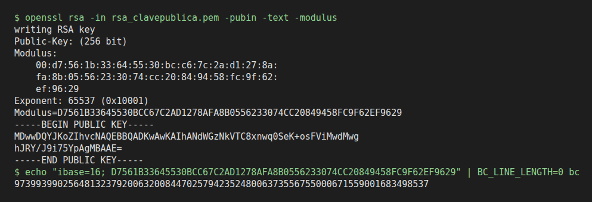
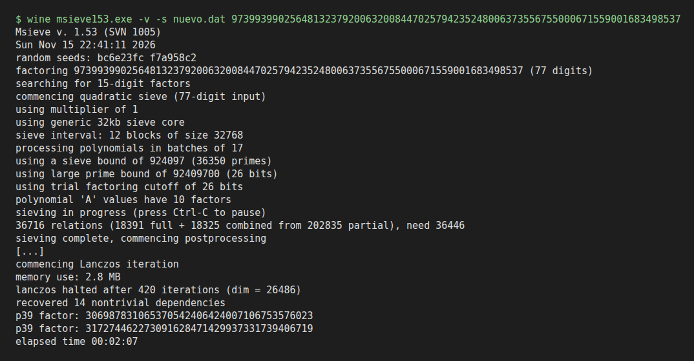
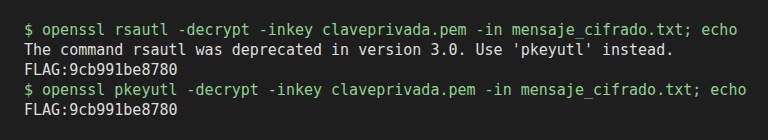

## Contexto

Un mensaje está cifrado con una clave pública RSA de 256 bits. La clave pública da el módulo *n* = *p* · *q* y el exponente *e*. Quien conoce *p* y *q* calcula el exponente privado *d*, el inverso de *e* módulo (*p* − 1)(*q* − 1), y descifra el mensaje.

Los pasos corren en Ubuntu con OpenSSL 3.0.13. `msieve153.exe` es un programa de Windows, y corre con `wine`. Las figuras muestran la salida de cada comando.

## Paso 1: el módulo y el exponente

`openssl rsa` muestra una clave de 256 bits, el exponente *e* = 65537 y el módulo en hexadecimal ([[fig-2-1]]). `bc` convierte el módulo a decimal sin redondeo, como pide la nota del enunciado: el módulo tiene 77 cifras.

## Paso 2: la factorización

El RAR trae un `msieve.dat` con las relaciones de una factorización anterior del mismo módulo. Con ese archivo, msieve no criba: lee las relaciones guardadas y termina en 4 segundos. La opción `-s nuevo.dat` le da un archivo vacío, y msieve hace la factorización completa ([[fig-3-1]]).

msieve usa la criba cuadrática y tarda 2 minutos y 7 segundos. Los dos factores primos tienen 39 cifras: *p* = `306987831065370542406424007106753576023` y *q* = `317274462273091628471429937331739406719`.

## Paso 3: la clave privada

El binario `get_priv_key` del RAR necesita `libcrypto.so.1.0.0`, y Ubuntu ya no la trae. El código fuente tampoco compila con OpenSSL 3: escribe directamente en los campos de la estructura `RSA`, y desde OpenSSL 1.1 esa estructura es opaca ([[fig-4-1]]). `lab/actividad2/get_priv_key_openssl3.c` cambia solo esas ocho asignaciones por las funciones `RSA_set0_key`, `RSA_set0_factors` y `RSA_set0_crt_params`.

El programa recibe *p*, *q* y *e*, y escribe la clave privada por la salida estándar. El comando la redirige a `claveprivada.pem`. La última línea de la [[fig-4-1]] comprueba el resultado: la clave pública que sale de `claveprivada.pem` es idéntica a `rsa_clavepublica.pem`.

## Paso 4: el mensaje

`openssl rsautl` descifra el mensaje con la clave privada ([[fig-5-1]]). OpenSSL 3 avisa de que `rsautl` está obsoleto, y `pkeyutl` da el mismo resultado. El mensaje descifrado es:

**`FLAG:9cb991be8780`**

## Conclusión

La seguridad de RSA depende del tamaño del módulo. Un módulo de 256 bits cae en minutos con un programa gratuito. El NIST pide un módulo de 2048 bits como mínimo [1], y ese tamaño queda fuera del alcance de la criba cuadrática y de la criba general del cuerpo de números.

## Referencias

[1] E. Barker, "Recommendation for Key Management: Part 1 – General", NIST SP 800-57 Part 1 Rev. 5, may. 2020, tabla 2. [En línea]. Disponible: <https://doi.org/10.6028/NIST.SP.800-57pt1r5>.
